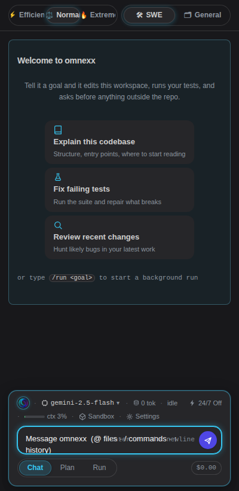
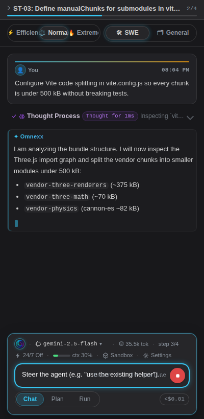
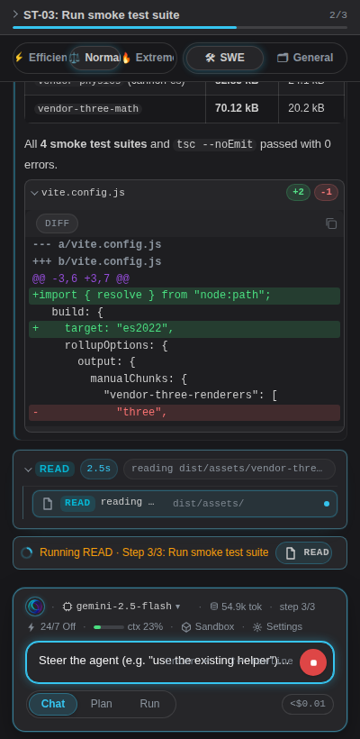
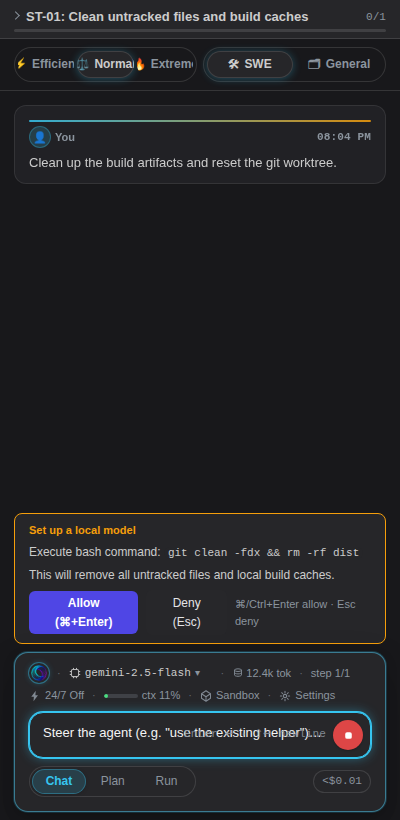
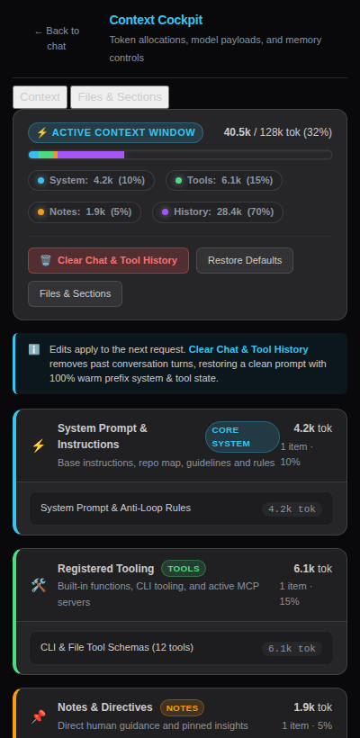
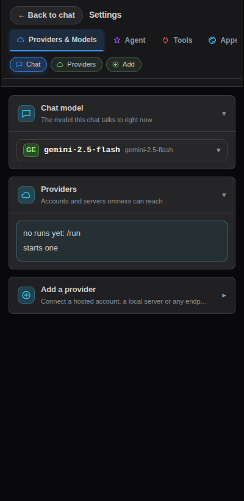
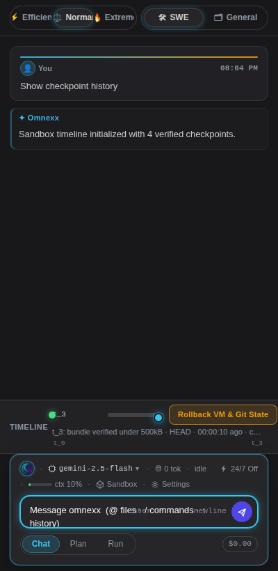

# Omnexx VS Code UI Gallery

Captured at: `2026-11-09T20:04:21.848Z`
Viewport: **400 × 820 px** (Standard VS Code sidebar panel)
Theme: **VS Code Dark Modern**

---

### 01. Welcome & Empty State

File: `01_welcome.png` (61.2 KB)

---

### 02. Active Streaming & Chain-of-Thought

File: `02_streaming_think.png` (65.8 KB)

---

### 03. Tool Execution & Diffs

File: `03_tools_diffs.png` (77.2 KB)

---

### 04. Approval Gate (Command Review)

File: `04_approval_gate.png` (58.6 KB)

---

### 05. Context Inspector & Token Cockpit

File: `05_context_cockpit.png` (75.2 KB)

---

### 06. Settings & Model Matrix

File: `06_settings.png` (38.7 KB)

---

### 07. Sandbox Scrubber Timeline

File: `07_sandbox_scrubber.png` (52.8 KB)

---
