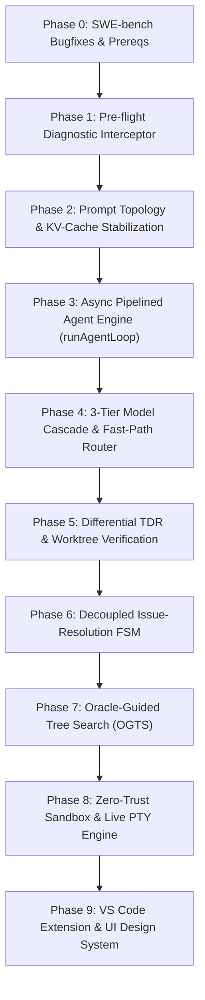

# Omnexx Master Engineering Roadmap & Step-by-Step Implementation Ledger

> **Autonomous Coding Agent Architecture & Execution Plan**  
> **Repository:** `yaegerbomb42/omnexx` (v0.26.17+) · **Runtime:** Node.js >= 22 (ESM) · TypeScript · Vitest  
> **Objective:** Systematically eliminate wasted agent turns, slash token expenditure by 60–80%, enforce >80% KV-cache hit ratios, and maximize benchmark pass consistency on SWE-bench Verified/Pro through deterministic pipelines, static analysis, and tree search.

---

## Master Architecture & Sequential Execution Flow

The implementation is ordered strictly by dependency, risk, and impact. Foundations and bugfixes come first, followed by transaction hygiene, caching, loop pipelining, routing, verification, state machines, and search algorithms.

---

## Phase 0: SWE-bench Core Remediation & Infrastructure Pre-requisites

_Before building advanced pipelines, the 9 identified defects in `src/swe-bench/` and benchmark runners must be resolved so diff extraction, reproduction runs, and evaluation tooling behave deterministically._

- [x] **Step 0.1: Standard Git Patch Prefixes**
  - **Files:** `src/swe-bench/patch-diff.ts`
  - **Action:** Drop the `--no-prefix` flag from `extractPatchDiff`. Ensure generated diffs include standard `a/` and `b/` prefixes so `git apply` and `patch -p1` resolve relative file paths properly on clean checkouts.
  - **Dependencies:** None
  - **Acceptance:** `git apply --check` succeeds on a clean worktree using diffs produced by `extractPatchDiff`.

- [x] **Step 0.2: Capture Untracked & Uncommitted Work in Patch Diffs**
  - **Files:** `src/swe-bench/patch-diff.ts`
  - **Action:** Modify `extractPatchDiff(root, ctx, base)` to capture working tree changes. Execute `git add -N .` (register untracked files into the index as intent-to-add) prior to executing `git diff --binary <base>`.
  - **Dependencies:** Step 0.1
  - **Acceptance:** Newly created files and uncommitted edits produce a non-empty patch diff when compared against `base`.

- [x] **Step 0.3: Fix AST Skeleton Symbol Line Ranges**
  - **Files:** `src/swe-bench/skeleton.ts`
  - **Action:** Refactor `buildSkeleton` to directly consume `Symbol.line` and `Symbol.endLine` already emitted by `extractSymbols`. Eliminate the naive substring search heuristic (`indexOf(name)`) which misidentifies imports, calls, or comments as symbol declarations.
  - **Dependencies:** None
  - **Acceptance:** Skeletons for functions with common names (e.g., `execute`, `run`, `init`) report exact AST line spans matching their declarations.

- [x] **Step 0.4: Secure Reproduction Test Runner**
  - **Files:** `src/swe-bench/reproduce.ts`
  - **Action:** Replace direct `node:child_process.exec` calls with `run.exec` from `src/core/exec.ts`. Enforce execution inside the Docker sandbox when configured, apply scrubbed `run.childEnv`, and ensure timeout termination triggers process-group kill (`process.kill(-pid, 'SIGTERM')`).
  - **Dependencies:** None
  - **Acceptance:** Running a long-running or malicious reproduction test terminates all grandchild processes without leaking host environment variables.

- [x] **Step 0.5: Failure Signature Validation for Reproduction Tests**
  - **Files:** `src/swe-bench/reproduce.ts`
  - **Action:** Replace `valid = !pass` with strict failure signature classification. Require tests to exit non-zero AND print expected error signatures matching the issue symptom. Reject syntax errors, missing module crashes, and timeouts from being marked as valid reproductions. Ensure test files are removed from the worktree upon completion.
  - **Dependencies:** Step 0.4
  - **Acceptance:** A test that crashes due to a typo or syntax error is classified as `INVALID_SYNTAX`, not `REPRODUCED`.

---

## Phase 1: Pre-flight Diagnostic Interceptor & Mutation Hygiene

_Embed static analysis and deterministic auto-repairs directly into the file-mutation transaction (`src/tools/edit.ts`, `replace-lines.ts`), eliminating LLM turns wasted discovering lint, formatting, or type errors._

- [x] **Step 1.1: Shared Preflight Interfaces & Diagnostic Normalization**
  - **Files:** `src/verify/preflight-types.ts`, `src/verify/diagnostics.ts`
  - **Action:**
    - Define `PreflightRequest`: `{ root: string; file: string; before: string; after: string; operation: string; signal?: AbortSignal }`.
    - Define `PreflightResult`: `{ formatted: boolean; fixed: number; diagnostics: Diagnostic[]; durationMs: number; status: "clean" | "issues" | "skipped" }`.
    - Define normalized `Diagnostic`: `{ file: string; line: number; column: number; code: string; severity: "error" | "warning" | "info"; message: string; source: string; fixable: boolean }`.
    - Implement LSP 0-based to editor 1-based coordinate conversion.
  - **Dependencies:** Phase 0
  - **Acceptance:** Vitest asserts raw diagnostics from TypeScript and ESLint convert into identical normalized tuples.

- [x] **Step 1.2: Pre-flight Orchestration Hub**
  - **Files:** `src/verify/preflight.ts`, `src/verify/index.ts`
  - **Action:** Implement `runPreflight(request: PreflightRequest): Promise<PreflightResult>`. Orchestrate sequence: language detection -> formatters -> safe autofix -> language server diagnostics -> baseline diffing -> compact formatting. Enforce a hard 4,000ms timeout budget for the entire preflight pass.
  - **Dependencies:** Step 1.1
  - **Acceptance:** `runPreflight` returns within 4,000ms even if underlying tools stall, marking timed-out checks as `skipped`.

- [x] **Step 1.3: Wire Mutation Tools Through Preflight**
  - **Files:** `src/tools/edit.ts`, `src/tools/replace-lines.ts`
  - **Action:**
    - Replace existing direct `afterEdit()` calls with `runPreflight()`.
    - For `multi_edit`: run a single preflight pass after all replacements have been applied.
    - If formatters or autofix mutated the file on disk, re-read contents before constructing tool output so the LLM never receives stale code.
    - Retain `diagnoseInMemory()` in `ts-check.ts` for candidate tournament scoring without touching disk.
  - **Dependencies:** Step 1.2
  - **Acceptance:** File edits with trailing semicolons or bad formatting return cleanly formatted snippets to the caller on the first turn.

- [x] **Step 1.4: Expand TypeScript Worker to Affected Reverse-Importers**
  - **Files:** `src/tools/ts-check.ts`, `src/tools/ts-worker.ts`, `src/verify/impact-analysis.ts`
  - **Action:** Retain the persistent Node.js worker thread containing `ts.createLanguageService()`. Compute immediate impact graph: changed file + direct reverse-importers. Query syntactic and semantic diagnostics across the impact set so breaking exported interface changes are caught immediately.
  - **Dependencies:** Step 1.3
  - **Acceptance:** Editing an interface in `types.ts` that breaks `consumer.ts` returns a compiler diagnostic for `consumer.ts` in the tool output.

- [x] **Step 1.5: Pre-Existing Baseline Diffing & Compact Feedback**
  - **Files:** `src/verify/diagnostic-baseline.ts`, `src/verify/diagnostics.ts`
  - **Action:**
    - Fingerprint diagnostics: `[file, code, line, col, message].join(":")`.
    - Compare post-edit diagnostics against pre-edit baseline so pre-existing repository errors are never reported as newly introduced regressions.
    - Enforce compact formatting: cap at top 5 highest-priority errors, max 180 chars per error, max 1,200 chars total feedback. Format as `PREFLIGHT: ISSUES FOUND ... [ERROR] file:line:col Code: msg`.
  - **Dependencies:** Step 1.4
  - **Acceptance:** Editing a file with 10 existing errors introduces 1 new error; preflight output reports exactly 1 new error.

- [x] **Step 1.6: In-Process ESLint Auto-Fixer**
  - **Files:** `src/verify/autofix.ts`
  - **Action:** Integrate Node.js `ESLint` API (`eslint.lintText(source, { filePath, fix: true })`). Resolve project-local ESLint config rooted at project root. Restrict automatic fixes to safe categories: `fixTypes: ["problem", "layout"]`. Write fixed content to disk and re-trigger diagnostic verification.
  - **Dependencies:** Step 1.5
  - **Acceptance:** Unused variables or layout issues configured in `.eslintrc` are fixed on disk automatically without an LLM turn.

- [x] **Step 1.7: Multi-Language Formatter Consolidation (Prettier, Ruff, gofmt, rustfmt)**
  - **Files:** `src/verify/formatters.ts`
  - **Action:** Consolidate formatting dispatch currently scattered across `post-edit.ts`. Respect project-local configs (`.prettierrc`, `ruff.toml`). Enforce bounded 500ms timeouts per formatter.
  - **Dependencies:** Step 1.6
  - **Acceptance:** Python files edit and format cleanly via Ruff; Go files format via gofmt; Rust files format via rustfmt.

- [x] **Step 1.8: Persistent Pyright & Rust-Analyzer LSP Integration**
  - **Files:** `src/verify/lsp/client.ts`, `src/verify/lsp/manager.ts`, `src/verify/lsp/pyright.ts`, `src/verify/lsp/rust-analyzer.ts`
  - **Action:** Implement persistent JSON-RPC client wrapping `vscode-jsonrpc` stdio streams. Maintain `Map<"${root}:${language}", PersistentLspClient>`. Register child processes with Omnexx's `process-registry.ts`. Add Pyright (`pyright-langserver --stdio`) with CLI fallback and `rust-analyzer` with `checkOnSave`.
  - **Dependencies:** Step 1.7
  - **Acceptance:** Editing a Python file with a type mismatch returns a Pyright type error in the preflight tool response.

- [x] **Step 1.9: Wire Self-Healing Symbol Matching into Edit Recovery**
  - **Files:** `src/tools/edit-recovery.ts`, `src/tools/fuzzy-match.ts`, `src/tools/edit.ts`
  - **Action:** Connect `findMatchingSymbol()` into `closestRegion()`. When exact and whitespace-normalized matching fails, scan for unique symbol definitions (`function`, `class`, `interface`) within a $\pm 20$ line window. If a single unique symbol matches with $>0.5$ Dice similarity, snap the recovery window to the symbol definition boundaries.
  - **Dependencies:** Step 1.3
  - **Acceptance:** An edit whose surrounding whitespace or comments drifted still locates and recovers the target symbol definition without emitting a brittle sliding-window miss.

- [x] **Step 1.10: Dynamic Span Resolution in Anchor Range Locator**
  - **Files:** `src/tools/anchors.ts`
  - **Action:** Update `locateRange()` for multi-line ranges (`want.length === 4`) to allow variable span drift. If `lineTag(s + span) !== endTag`, search $s + \text{span} \pm 10$ lines for `endTag`. If found, return `{ ok: true, start: s, end: matchedEnd, moved: true }`.
  - **Dependencies:** None
  - **Acceptance:** Multi-line anchor ranges resolve cleanly even after previous edits inserted or deleted lines inside the block.

- [x] **Step 1.11: Semantic Hard Capping & Compiler Error Truncation**
  - **Files:** `src/tools/output-compress.ts`
  - **Action:**
    - Add `foldCompilerErrors()`: If `tsc`, `pyright`, or `rustc` emits $>5$ errors, keep the first 3 errors and collapse the rest into `[... X more compiler errors collapsed]`.
    - Add `foldPytestWarnings()`: Strip `=== warnings summary ===` blocks.
    - Enforce `MAX_COMPRESSED_CHARS` (default 2,500): Keep top 1,500 chars (command + first fatal error) and bottom 800 chars (summary line), dropping intermediate noise.
  - **Dependencies:** None
  - **Acceptance:** High-output build/test failures never exceed 2,500 characters in the agent conversation context.

---

## Phase 2: Prompt Topology & >80% KV-Cache Prefix Stabilization

_Re-architect `src/core/` and `src/providers/` to maintain strict byte-for-byte prefix stability, unlocking 40–72% input cost reductions and dropping Time-to-First-Token (TTFT) from ~3–4s to <500ms._

- [x] **Step 2.1: Audit & Genericize Tool Schemas**
  - **Files:** `src/tools/registry.ts`, `src/tools/contract.ts`, `src/tools/`
  - **Action:** Strip all dynamic workspace paths, active file lists, and session timestamps from tool descriptions and parameters. Ensure tool schemas remain 100% static and generic across sessions. Move all project-specific pathing into the Level 1 System Prompt block.
  - **Dependencies:** None
  - **Acceptance:** Tool schemas serialized to JSON remain identical byte-for-byte across two distinct repository sessions.

- [x] **Step 2.2: Purge Ephemeral Tokens from System Prefix**
  - **Files:** `src/core/prompt.ts`, `src/agent/prompts.ts`, `src/core/running-context.ts`
  - **Action:** Remove shifting timestamps (`Current Time: {{timestamp}}`), randomized UUIDs, and volatile turn counters from the initial system prompt. Move volatile session metadata to the dynamic user prompt edge.
  - **Dependencies:** Step 2.1
  - **Acceptance:** SHA-256 hash of the initial system prompt prefix remains stable across consecutive turns within a session.

- [x] **Step 2.3: Deterministic Serialization for OpenAI Endpoints**
  - **Files:** `src/providers/openai-compat.ts`, `src/providers/cache-pinning.ts`
  - **Action:** Implement deterministic JSON serialization using `fast-json-stable-stringify` (or equivalent key-sorting serializer) for tools arrays and system messages before sending to OpenAI/DeepSeek endpoints.
  - **Dependencies:** Step 2.2
  - **Acceptance:** Two requests containing identical tool definitions in differing JavaScript object property orders produce identical payload strings.

- [x] **Step 2.4: Three-Level Prompt Topology Assembler**
  - **Files:** `src/core/prompt-assembler.ts`, `src/core/prompt.ts`
  - **Action:** Build `CacheOptimizedAssembler` partitioning prompts into:
    - **Level 0 (Immutable Core):** Agent identity, behavioral guardrails, generic tool schemas.
    - **Level 1 (Session Semi-Static):** Project AST RepoMap, environment facts (OS, language versions, root paths).
    - **Level 2 (Dynamic Sliding Window):** Append-only message history, current task, edge summary.
  - **Dependencies:** Step 2.3
  - **Acceptance:** Generated prompts strictly maintain Level 0 and Level 1 content before Level 2 dynamic messages.

- [x] **Step 2.5: Anthropic Dual-Breakpoint Injection & Provider Cache Headers**
  - **Files:** `src/providers/cache-headers.ts`, `src/providers/anthropic.ts`, `src/providers/cache-pinning.ts`
  - **Action:** In `buildAnthropicPayload` and `injectPromptCaching`, inject `cache_control: { type: "ephemeral" }` at:
    - Breakpoint 1: End of Level 0 System Core block.
    - Breakpoint 2: End of Level 1 RepoMap / Environment block.
    - Breakpoint 3: Rolling checkpoint at 2nd-to-last turn in conversation history.
  - **Dependencies:** Step 2.4
  - **Acceptance:** Anthropic API responses report `cache_read_input_tokens > 0` starting from Turn 2 onwards.

- [x] **Step 2.6: Google Gemini Context Caching API Integration**
  - **Files:** `src/providers/gemini-cache.ts`, `src/providers/gemini.ts`
  - **Action:** Implement a Gemini `CacheManager` calling `/v1beta/cachedContents` with Level 0 + Level 1 content for context sessions $\ge 32,768$ tokens. Pass returned `cachedContent` ID to subsequent `generateContent` calls. Add 5-minute TTL reuse and automatic fallback to un-cached requests if rejected or expired.
  - **Dependencies:** Step 2.4
  - **Acceptance:** Gemini API calls reference pre-created `cachedContent`, reducing billable input tokens.

- [x] **Step 2.7: Edge Summary Pattern for Context Window Compaction & Cache Meter**
  - **Files:** `src/telemetry/cache-meter.ts`, `src/core/prompt-assembler.ts`, `src/agent/compaction.ts`
  - **Action:** Replace prefix-shifting history summarization (which mutates old turns in-place and invalidates the cache). Implement the Edge Summary pattern: append rolling `<history_summary>` to the dynamic user edge while keeping Level 0 and Level 1 prefixes completely intact. Track KV cache hit-ratios via `CacheMeter`.
  - **Dependencies:** Step 2.4
  - **Acceptance:** Compacting context during a 30-turn session maintains $>80\%$ provider cache hit ratio.

---

## Phase 3: Asynchronous Pipelined Agent Engine (`runAgentLoop`)

_Overhaul `src/agent/loop.ts` to support wave-pipelined tool concurrency, mid-turn steering interruption, micro-amortized compaction, and speculative branch rollback._

- [x] **Step 3.1: Tool Concurrency Classification & Wave Planner**
  - **Files:** `src/agent/runtime/tool-scheduler.ts`, `src/agent/loop.ts`
  - **Action:**
    - Classify tools: `READ_PARALLEL` (read_file, search, grep, glob, list_dir, view_symbol), `MUTATE_SERIAL` (write_file, edit_file), `RISKY_CHECKPOINT` (bash, multi_edit, delete_file).
    - Implement `buildExecutionWaves(toolCalls, registry)`: group contiguous read calls into concurrent waves; treat write/exec as serialization barriers.
    - Fail-safe default: unknown tools classify as `MUTATE_SERIAL`.
  - **Dependencies:** Phase 1, Phase 2
  - **Acceptance:** A turn emitting 4 `read_file` calls and 1 `write_file` call batches the 4 reads into wave 1 and runs the write in wave 2.

- [x] **Step 3.2: Concurrent Tool Execution with Deterministic Result Ordering**
  - **Files:** `src/agent/runtime/tool-scheduler.ts`
  - **Action:**
    - Execute parallel read batches via `Promise.allSettled()` with a concurrency limiter (`maxConcurrency: 4`).
    - Store outcomes in pre-allocated slots matching original LLM call order: `orderedResults[originalIndex] = result`.
    - Emit `tool_result` envelopes in model order to guarantee strict `tool_use`/`tool_result` pairing for provider API contracts.
  - **Dependencies:** Step 3.1
  - **Acceptance:** Turn execution time for multiple reads scales with $O(\max(t_i))$ rather than $O(\sum t_i)$, while message history retains original call order.

- [x] **Step 3.3: Decoupled Mid-Turn Interrupt Bus (`TurnInterruptBus`)**
  - **Files:** `src/agent/runtime/interrupt-bus.ts`, `src/agent/loop.ts`
  - **Action:**
    - Create `TurnInterruptBus`:
      - `cancel` / fatal `resource`: Latches terminal state and exits after current turn settles.
      - `steer`: Aborts in-flight turn, injects `<steering_signal>` text into next user message, and re-arms without terminating the session.
    - Wire Node.js 22 `AbortSignal.any([outerSignal, bus.signal])` to model streaming and tool processes.
  - **Dependencies:** Step 3.2
  - **Acceptance:** Triggering steering during a slow tool aborts that tool immediately and proceeds to the next turn with steering context.

- [x] **Step 3.4: Provider Invariant Pairing on Interrupted Batches**
  - **Files:** `src/agent/loop.ts`, `src/agent/runtime/interrupt-bus.ts`
  - **Action:** If an in-flight tool wave is interrupted, preserve all settled tool results. For unstarted or aborted `tool_use` blocks, synthesize deterministic `[Tool interrupted mid-flight by steering signal]` envelopes. Never emit orphaned `tool_use` blocks.
  - **Dependencies:** Step 3.3
  - **Acceptance:** Simulating mid-batch abort never produces a 400 Bad Request error on subsequent model calls.

- [x] **Step 3.5: Micro-Amortized History Compaction**
  - **Files:** `src/agent/runtime/micro-compaction.ts`, `src/agent/compaction.ts`
  - **Action:**
    - Implement `microCompact(messages, options)` operating strictly outside the pinned prefix and hot recent message window.
    - Rule A: Stub superseded identical read/search tool outputs (`[μc] superseded: identical read_file call repeated later`).
    - Rule B: Collapse verbose error traces to single-line summaries once a subsequent turn succeeds (`[μc] resolved error: ...`).
    - Rule C: Truncate cold outputs exceeding `maxColdChars: 2000`.
    - Enforce a compaction stride (default every 4 turns): `turn % stride === 0` to preserve prompt cache stability.
  - **Dependencies:** Step 3.4
  - **Acceptance:** History token count decreases after repetitive read turns while prefix cache hit ratio remains $>80\%$.

- [x] **Step 3.6: Throwaway Git-Tree Snapshotter**
  - **Files:** `src/agent/runtime/checkpoint.ts`, `src/git/checkpoint.ts`
  - **Action:** Implement `GitTreeSnapshotter` using an isolated throwaway git index (`GIT_INDEX_FILE` in `os.tmpdir()`). Capture tree SHA via `git write-tree` in <50ms without modifying the user's HEAD, index, or branch refs. Implement restore using `git checkout-index` and directory cleaning.
  - **Dependencies:** None
  - **Acceptance:** Snapshotting and restoring workspace state takes <100ms and cleans up newly created untracked files.

- [x] **Step 3.7: Speculative Branch Rollback & Intervention Injection**
  - **Files:** `src/agent/runtime/rollback.ts`, `src/agent/runtime/checkpoint.ts`, `src/agent/loop.ts`
  - **Action:**
    - Automatically arm checkpoints before turns executing `RISKY_CHECKPOINT` tools (`bash`, `multi_edit`).
    - When `stuckNudge` trips or test verification fails:
      - Restore workspace files to snapshot ref.
      - Truncate conversation history to pre-mutation turn index.
      - Inject structured `<system_intervention type="branch_rollback">` lesson so the model formulates an alternative approach.
    - Bound rollbacks per run: `maxRollbacksPerRun: 2`.
  - **Dependencies:** Step 3.6
  - **Acceptance:** A destructive bash failure triggers automatic workspace restore and conversation rollback, removing corrupted output from context.

- [x] **Step 3.8: Layer 0 Characterization & Concurrency Test Suite**
  - **Files:** `test/unit/agent/loop-characterization.test.ts`, `test/unit/agent/loop.spec.ts`
  - **Action:** Record golden message transcripts from the legacy loop. Run characterization tests asserting byte-for-byte transcript equality with `maxToolConcurrency: 1`. Author unit tests asserting concurrent tool speedup, interrupt pairing invariants, and checkpoint rollback.
  - **Dependencies:** Steps 3.1–3.7
  - **Acceptance:** All characterization and concurrency tests pass in Vitest.

---

## Phase 4: 3-Tier Dynamic Model Cascade & Fast-Path Router

_Offload 70–80% of routine exploration and formatting turns to low-cost Tier 1/2 models ($0.02–$0.25/1k tokens), reserving Tier 3 frontier models ($10.00/1k tokens) for multi-file root-cause repair._

- [x] **Step 4.1: Deterministic $O(1)$ Fast-Path Action Classifier**
  - **Files:** `src/router/classify.ts`, `src/router/actions.ts`
  - **Action:** Expand `cycleAction` with high-confidence regex rules mapping operations to Tier 1:
    - Reconnaissance: `grep`, `find_files`, `read_symbol`, `list_directory`, `git_status`, `git_log`.
    - Mechanical edits: formatting passes, comment fixes, single-line variable renames.
    - Guarantee $O(1)$ zero-overhead routing decision time (<1ms) without calling an LLM or embedding model.
  - **Dependencies:** Phase 3
  - **Acceptance:** 100% of standard file-read and grep actions classify to Tier 1 with <1ms latency.

- [x] **Step 4.2: Cheap Role Chain Binding & Tool Schema Pruning**
  - **Files:** `src/router/router.ts`, `src/router/pool.ts`
  - **Action:** Bind Tier 1 directly to Omnexx's `roleChains.cheap` pool (Gemini Flash, Claude Haiku, or local Ollama). Prune tool schemas sent to Tier 1 to only include tools relevant to reconnaissance, saving tokens.
  - **Dependencies:** Step 4.1
  - **Acceptance:** Tier 1 calls execute against cheap models with lightweight context payloads.

- [x] **Step 4.3: Semantic Complexity Scoring & Stage Policies**
  - **Files:** `src/router/stage.ts`, `src/router/classify.ts`
  - **Action:** Implement fast complexity classification:
    - Tier 3 (Frontier): Multi-file tasks (>3 files), architectural changes, auth/db layers, prior test failures.
    - Tier 2 (Mid-tier): Single-module unit test authoring, localized fixes with stack traces.
    - Strict rule for `src/judge/`: never use an expensive Tier 3 model to evaluate routing decisions.
  - **Dependencies:** Step 4.2
  - **Acceptance:** Complex multi-file refactors route to Tier 3; localized test updates route to Tier 2.

- [x] **Step 4.4: In-Flight Escalation Circuit Breaker (`MAX_CALLS_PER_TIER = 2`)**
  - **Files:** `src/router/circuit-breaker.ts`, `src/router/router.ts`, `src/agent/loop.ts`
  - **Action:** Track consecutive attempts per tier in `RouteContext`. If a Tier 1 or Tier 2 model fails to resolve an action within 2 calls, immediately promote to the next tier. Wire 4 automated escalation triggers:
    1. `SYNTAX_ERROR`: Intercepted preflight syntax error.
    2. `TEST_REGRESSION`: Test suite reports a new failure.
    3. `PARSE_FAILURE`: Model output violates structured tool schema.
    4. `ITERATION_EXCEEDED`: Sub-task turn count exceeds budget.
  - **Dependencies:** Step 4.3
  - **Acceptance:** A Tier 1 model generating a syntax error triggers immediate escalation to Tier 2 on turn 2.

- [x] **Step 4.5: Context-Preserving Escalation Handoff**
  - **Files:** `src/router/escalation-handoff.ts`, `src/agent/loop.ts`, `src/router/router.ts`
  - **Action:** When escalating to Tier 3, summarize accumulated lower-tier turns using the Edge Summary pattern before invoking the frontier model. Inject an escalation steering note: `"ESCALATION: Lower-tier model encountered [trigger]. Elevating to frontier reasoning to resolve root cause."`
  - **Dependencies:** Step 4.4
  - **Acceptance:** Frontier models receive concise context upon escalation without duplicate raw tool dumps.

- [x] **Step 4.6: Real-Time Tier Cost Accounting Ledger**
  - **Files:** `src/providers/pricing.ts`, `src/providers/usage-ledger.ts`
  - **Action:** Attribute token counts and dollar spend to specific tiers (`tier1_cost`, `tier2_cost`, `tier3_cost`). Calculate cumulative savings against the all-frontier baseline ($C_{single} = C_3 \times T_3 / 1000$). Emit `router.escalation` and `router.decision` events.
  - **Dependencies:** Step 4.5
  - **Acceptance:** Usage ledger accurately splits costs across tiers, demonstrating >65% cost reduction on benchmark tasks.

---

## Phase 5: Differential Test-Driven Repair & Transient Worktree Verification

_Enforce strict differential verification: a candidate patch is never accepted merely because a test passes; it must satisfy a 3-way differential matrix inside an isolated Git worktree._

- [x] **Step 5.1: Symptom-Focused Reproduction Test Synthesizer**
  - **Files:** `src/verify/spec-tests.ts`, `src/agent/prompts.ts`
  - **Action:** Format bug inputs into symptom-focused prompts containing: issue body, stack trace, suspect function excerpt, and nearest test patterns. Explicitly strip causal hints to prevent synthesizer bias. Enforce structured output returning `{ status: "ok", testContent: string }` or `{ status: "insufficient_evidence", reason: string }`.
  - **Dependencies:** Phase 0, Phase 1
  - **Acceptance:** Synthesizer generates a standalone test reproducing the reported symptom without receiving fix clues.

- [x] **Step 5.2: Determinism Controls & Test File Isolation**
  - **Files:** `src/verify/spec-tests.ts`
  - **Action:** Write generated tests to `.omnexx-repro/__repro_<sha256>.test.ts`. Automatically inject determinism mocks: `vi.useFakeTimers()`, fixed PRNG seeds, and `process.env.NODE_ENV = 'test'`. Add `.omnexx-repro/` to `.git/info/exclude`.
  - **Dependencies:** Step 5.1
  - **Acceptance:** Generated tests run deterministically across repeated executions with fixed clocks and seeds.

- [x] **Step 5.3: Transient Worktree Lifecycle Manager**
  - **Files:** `src/git/worktree.ts`, `src/core/process-registry.ts`
  - **Action:** Implement `createVerificationWorktree(repoRoot, baseSha, candidateDiff)`. Provision detached worktree at `.worktrees/verify-<timestamp>`. Apply candidate diff via `git apply --whitespace=fix` strictly inside the worktree. Avoid symlinking `node_modules` across workspaces (prevent Vitest from resolving primary tree source files). Ensure `cleanup()` reliably calls `git worktree remove --force`.
  - **Dependencies:** Step 0.1, Step 0.2
  - **Acceptance:** Candidate diffs apply and execute in isolated worktrees with zero modification to the primary git checkout.

- [x] **Step 5.4: Resource-Bounded Sandboxed Test Runner**
  - **Files:** `src/verify/serve.ts`, `src/tools/bash.ts`
  - **Action:** Wrap test execution using `node:child_process.execFile` (strictly avoid shell interpolation). Enforce bounds: `timeoutMs: 60_000`, `maxBuffer: 20 * 1024 * 1024`. Bound V8 heap and concurrency via environment: `--max-old-space-size=512`, `VITEST_MAX_THREADS=2`.
  - **Dependencies:** Step 5.3
  - **Acceptance:** Tests exceeding 60s or 512MB RAM terminate cleanly without hanging the runner.

- [x] **Step 5.5: 3-Way Differential Matrix Orchestrator & 4-Way Gate Evaluator**
  - **Files:** `src/verify/gates.ts`, `src/verify/flaky.ts`
  - **Action:**
    - Build `runDifferentialMatrix(repoRoot, baseSha, candidateDiff, reproTestPath)`.
    - Run 1 (Pre-patch on baseline): Must FAIL (exit != 0). If passes $\to$ `reject_repro`.
    - Run 2 (Post-patch on worktree): Must PASS (exit 0). If fails $\to$ `reject_fix`.
    - Run 3 (Full baseline regression suite on both trees): Regression delta must be 0 (`regressions.length === 0`). If delta > 0 $\to$ `reject_regression`.
    - Quarantine flaky tests before regression calculation.
  - **Dependencies:** Step 5.4
  - **Acceptance:** Candidates introducing regressions or failing to reproduce the issue on baseline are rejected with typed exit codes.

- [x] **Step 5.6: Strategy Branching & Immutable Evidence Bundle**
  - **Files:** `src/git/rollback.ts`, `src/verify/evidence.ts`, `src/agent/loop.ts`
  - **Action:**
    - On gate rejection, force-remove transient worktrees and route to strategy branches:
      - `reject_repro`: Re-localize with full stack trace or quarantine as flaky.
      - `reject_fix`: Discard patch, feed post-patch test error back to repair agent.
      - `reject_regression`: Retain reproduction test, discard patch, add broken test names as hard negative constraints.
    - Require every "completed" declaration to persist an immutable Evidence Bundle: `{ prePatchReport, postPatchReport, regressionDelta, synthesizedTest, baseSha, targetSha }`.
  - **Dependencies:** Step 5.5
  - **Acceptance:** Failed attempts trigger specific recovery strategies; commit gates reject merges lacking an evidence bundle.

---

## Phase 6: Decoupled Issue-Resolution FSM & SWE-bench Engine

_Replace divergent ReAct loops with a deterministic Finite State Machine (FSM) where code controls flow and the model only fills typed slots, incorporating bounded agency and lexicographical candidate ranking._

- [x] **Step 6.1: FSM State Schema, Context & Visit Caps**
  - **Files:** `src/agent/fsm/types.ts`
  - **Action:** Define states: `INTAKE`, `A_LOCALIZE`, `B_SPECIFY`, `C_SYNTHESIZE`, `D_VERIFY`, `E_SELECT`, `F_FINALIZE`, and terminal states (`DONE_VERIFIED`, `DONE_UNVERIFIED`, `DONE_NO_PATCH`, `ABORT_ENV`, `ABORT_BUDGET`). Define `FsmContext` tracking visits, transitions, rung, evidence, tombstones, and seen input hashes. Enforce `VISIT_CAP` and `MAX_TRANSITIONS = 40`.
  - **Dependencies:** Phase 0–5
  - **Acceptance:** Transition graph conforms to Zod schemas; exceeding visit caps takes exhausted edges.

- [x] **Step 6.2: Pure Transition Machine & Crash-Safe Runner**
  - **Files:** `src/agent/fsm/machine.ts`, `src/agent/fsm/runner.ts`
  - **Action:** Implement pure `step(ctx, ev): { ctx, next, effect }`. Implement crash-safe runner: read `ctx.json` $\to$ `step()` $\to$ atomic write `ctx.json` (fsync + rename) $\to$ execute effect $\to$ emit next event. Implement artifact persistence under `$OMNEXX_HOME/runs/<runId>/fsm/`. Implement idempotent crash resume matching `inputHash`.
  - **Dependencies:** Step 6.1
  - **Acceptance:** Killing process mid-run and resuming recovers exact state without repeating completed model calls.

- [x] **Step 6.3: Universal `structuredCall` Contract**
  - **Files:** `src/agent/fsm/structured.ts`
  - **Action:** Implement `structuredCall<T>(run, spec: StructuredSpec<T>)`. Force single answer tool via `z.toJSONSchema(spec.schema)` on `run.cheapComplete`. Run deterministic ground-truth validators (paths exist, spans in range). Provide at most 2 repair turns showing validation errors, 1 model escalation, then typed `SCHEMA_EXHAUSTED`.
  - **Dependencies:** Step 6.2
  - **Acceptance:** Malformed model responses are repaired within 2 turns or safely escalated.

- [x] **Step 6.4: Phase A Hierarchical Localization & Bounded Exploration (A4)**
  - **Files:** `src/agent/fsm/phases/localize.ts`
  - **Action:**
    - A1: File-level ranking using key terms and call-graph skeletons (cheap model).
    - A2: Element-level localization (worker model).
    - A3: Line-span extraction across 2 samples (worker model).
    - A4 Bounded Agency Step (active when confidence < 0.5):
      - Tool allow-list strictly enforced: `read_symbol`, `outline`, `search` (ripgrep), and line-bounded `read`. Write tools absent from registry.
      - Hard bounds: max 8 calls, max 3 per tool, max 12k output tokens, 90s timeout.
      - Typed exit enforcing `EditSpans` schema.
  - **Dependencies:** Step 6.3
  - **Acceptance:** Unlocalized issues trigger A4 exploration, which terminates within 8 calls without write permissions.

- [x] **Step 6.5: Phase B Specification & Reproduction Admission**
  - **Files:** `src/agent/fsm/phases/specify.ts`
  - **Action:** B1: Generate `IntentSpec` (root cause, fix strategy, edge cases). B2: Generate reproduction tests (3 samples); execute against baseline commit. Admit tests only if classified `REPRODUCED` stably on 2 consecutive runs. If no test passes admission, set `reproStatus = "unavailable"` (falling back to regression-only ranking).
  - **Dependencies:** Step 6.4, Step 5.5
  - **Acceptance:** Only reliable reproduction tests are admitted to rank candidate patches.

- [x] **Step 6.6: Phase C Candidate Synthesis with Constructive Diversity (N=3)**
  - **Files:** `src/agent/fsm/phases/synthesize.ts`
  - **Action:** Enforce diverse generation across 3 candidates:
    - $c_0$: Location L1, Hypothesis H1, $T=0.0$, worker model, direct fix.
    - $c_1$: Location L1, Hypothesis H2, $T=0.3$, worker model, minimal change.
    - $c_2$: Location L2, Hypothesis H1, $T=0.3$, alternate model from pool, fix at origin.
    - Hide reproduction test source code from Phase C prompts (prevent fitting literals).
    - Ephemeral worktree provisioning per candidate (`git worktree add`).
    - Pre-test static filter: syntax parse + project linter delta (drop candidates adding diagnostics before running tests).
  - **Dependencies:** Step 6.5, Step 5.3
  - **Acceptance:** 3 structurally distinct candidates generate in parallel; syntax-broken candidates are dropped before test execution.

- [x] **Step 6.7: Phase D Parallel Verification & Import-Path Sentinel**
  - **Files:** `src/agent/fsm/phases/verify.ts`
  - **Action:** Execute test suites in parallel across candidate worktrees. Run Import-Path Sentinel (`python -c "import pkg; print(pkg.__file__)"`): verify package resolves inside the candidate worktree, not host editable install. Mark `ENV_ERROR` on path escape. Parse test results by test ID.
  - **Dependencies:** Step 6.6
  - **Acceptance:** Candidates execute tests in parallel; false greens from host package resolution are caught.

- [x] **Step 6.8: Lexicographical Candidate Ranker (`rankKey`) & Circuit Breakers**
  - **Files:** `src/agent/fsm/phases/select.ts`, `src/agent/fsm/breakers.ts`
  - **Action:**
    - Implement `rankKey`: 1. `clean` $\to$ 2. `newFailures.length` $\to$ 3. `repro` pass/fail $\to$ 4. `extraCasesFailed` $\to$ 5. `literalLeaks` (overfitting guard checking verbatim literals from issue/test) $\to$ 6. `-clusterSize` $\to$ 7. `diffLines`, `filesTouched`, `index`.
    - Implement Breakers B1–B15, including B9 (force axis change on repeated failure keys) and B10 (stop sampling after 2 unimproved rounds).
    - Implement 5-rung escalation ladder.
    - Implement Phase F pristine-base checkout verification and output `prediction.json`.
  - **Dependencies:** Step 6.7
  - **Acceptance:** Best candidate is chosen deterministically; repeated failure keys force strategy changes.

---

## Phase 7: Oracle-Guided Tree Search (OGTS) & Hybrid Verification

_Deploy epoch-based tree search over a Directed Acyclic Graph (DAG) with adaptive branching, two-strike pruning, behavioral clustering, and hybrid verifiers._

- [x] **Step 7.1: Search Node Schema & DAG Transposition Table**
  - **Files:** `src/agent/search/types.ts`, `src/agent/search/transposition.ts`
  - **Action:** Define `SearchNode`: `{ id, parent, kind, snapshot, patch_hash, context_ref, oracle, Q, N, prior, cost, status }`. Implement `TranspositionTable`: index nodes by `(patch_hash, oracle_signature)` to merge converging branches into a DAG and eliminate redundant test executions.
  - **Dependencies:** Phase 5, Phase 6
  - **Acceptance:** Two distinct exploration trajectories arriving at the same patch diff merge into a single DAG node.

- [x] **Step 7.2: Search Engine Dispatcher (Best-First, PUCT, Beam Modes)**
  - **Files:** `src/agent/search/engine.ts`, `src/agent/search/snapshot.ts`
  - **Action:** Implement Best-First priority queue ($\text{priority}(s) = V(s) + \lambda \cdot \text{novelty}(s) - \mu \cdot \text{cost}(s)$) and PUCT mode with depth-bonus factor for wide/shallow exploration. Implement prefix-reusing forks from parent Git snapshot refs. Add parallel worker virtual loss.
  - **Dependencies:** Step 7.1
  - **Acceptance:** Workers explore divergent branches concurrently without duplicating effort.

- [x] **Step 7.3: Adaptive Semantic Branching & Stage Temperature Schedule**
  - **Files:** `src/agent/search/branching.ts`, `src/agent/search/sampling.ts`
  - **Action:**
    - Enforce wide-and-shallow defaults: `LOCALIZE` (3–5 branches), `PLAN` (2–3 branches), `EDIT` (4–8 branches), `TEST`/`REPAIR` (1 branch).
    - Stage temperature schedule: Localization/Planning $T \in [0.2, 0.4]$; Patch Synthesis $T \in [0.5, 0.8]$; Exploration/Repair $T \in [0.7, 1.0]$; Verifier/Judge $T \in [0.0, 0.2]$.
  - **Dependencies:** Step 7.2
  - **Acceptance:** Branching factor scales dynamically with task ambiguity while intra-epoch tool loops remain linear.

- [x] **Step 7.4: Two-Strike Pruning Engine**
  - **Files:** `src/agent/search/pruning.ts`
  - **Action:** Implement normalized error signatures (strip line numbers, addresses, timestamps). Enforce two-strike rules:
    - Kill on 2 consecutive patch apply/parse failures.
    - Kill on 2 consecutive identical compile/lint errors.
    - Kill on 3 consecutive tool errors of the same class.
    - Kill on 2 consecutive no-progress turns.
    - Kill on cycle detection or diff oscillation ($A \to B \to A$).
    - Immediate rollback on P2P regression (`regressions > 0`); kill branch only if unrecovered after 1 repair attempt.
  - **Dependencies:** Step 7.3
  - **Acceptance:** Branches exhibiting repetitive error patterns or regressions are pruned within 2 turns, preserving compute.

- [x] **Step 7.5: Behavioral Signature Clustering (AlphaCode 2 Pattern)**
  - **Files:** `src/agent/search/clustering.ts`
  - **Action:** Run generated candidate patches against small suites of generated test inputs. Hash execution stdout/stderr vectors to establish behavioral signatures. Cluster semantically equivalent patches; select 1 representative patch per cluster for downstream verification.
  - **Dependencies:** Step 7.4
  - **Acceptance:** Redundant patches with identical runtime behaviors are deduplicated before running full regression suites.

- [x] **Step 7.6: Hybrid Verifier Cascade ($s_H = \text{Top}_n(s_{EF}) + s\_{EB}$)**
  - **Files:** `src/agent/search/oracle.ts`, `src/agent/search/ranker.ts`
  - **Action:** Implement 4-tier oracle cascade: Static parse/compile $\to$ Targeted reproduction $\to$ P2P regression $\to$ Generated adversarial edge cases (AdverMCTS check). Terminate cascade at first decisive failure. Implement hybrid verifier: score finalists with Execution-Free (EF) model plausibility, then rank top $n$ via Execution-Based (EB) regression scores.
  - **Dependencies:** Step 7.5
  - **Acceptance:** High-confidence patches that pass both semantic inspection and differential test suites win selection.

- [x] **Step 7.7: Adaptive Budget Tier Governor**
  - **Files:** `src/agent/search/budget.ts`
  - **Action:** Classify tasks into budget tiers:
    - Tier S: 1 candidate, 1 node (estimated pass@1 > 0.65).
    - Tier M: 4–8 candidates, 10–20 nodes (0.35 < pass@1 < 0.65).
    - Tier L: 16–32 candidates, 30–60 nodes (pass@1 < 0.35 and high task value).
    - If verifier precision on pilot data < 0.70, lock budget to Tier S to prevent noise amplification.
  - **Dependencies:** Step 7.6
  - **Acceptance:** Easy tasks complete cheaply; complex tasks scale search compute adaptively.

---

## Phase 8: Zero-Trust Sandbox & Live PTY Terminal Engine

_Implement complete workspace isolation, multi-runtime containment (worktree jails, rootless Docker, Colima/Apple microVMs), and real-time bi-directional PTY streaming under `src/sandbox/`._

- [x] **Step 8.1: Workspace Sandbox Manager & Domain Detection**
  - **Files:** `src/sandbox/types.ts`, `src/sandbox/workspace-manager.ts`
  - **Action:**
    - Define `SandboxSession`, `SandboxMode` (`'worktree' | 'docker' | 'vm' | 'vault'`), and `SandboxStatus`.
    - Implement `detectTargetDomain(targetPath)`:
      - `existing_git`: Run `git worktree add -b omnexx/<id> ~/.omnexx/sandboxes/<id> HEAD`. Zero disk copy overhead; user's uncommitted host changes remain 100% untouched.
      - `fresh_repo`: Run `mkdir -p ~/.omnexx/sandboxes/<id>`, run `git init`, create baseline commit.
      - `artifact_vault`: Non-code tasks (travel planning, docs) initialize `~/.omnexx/vaults/<id>`, disable code compilers, and enforce structured data output.
    - Implement `finalizeSandbox(session, destinationPath, approve)`: on approval, merge squashed commits; on abort/failure, execute `git worktree remove --force` with zero host contamination.
  - **Dependencies:** Phase 0, Phase 5
  - **Acceptance:** Sandbox provisioning creates isolated worktree shadows for git repos and initialized vaults for non-code goals.

- [x] **Step 8.2: Worktree Path-Jail Containment Runtime**
  - **Files:** `src/sandbox/runtime/runtime.interface.ts`, `src/sandbox/runtime/worktree-runtime.ts`
  - **Action:**
    - Define `ISandboxRuntime`: `{ id, mode, start(), execute(cmd, opts), spawnPty(cmd, args, opts), cleanup() }`.
    - Build `WorktreeRuntime` as zero-dependency default fallback. Execute commands strictly within the worktree cwd with path normalization blocking `../` traversal or symlink escapes outside the sandbox root.
  - **Dependencies:** Step 8.1
  - **Acceptance:** Commands attempting to read or write files outside `~/.omnexx/sandboxes/<id>` throw access denied errors.

- [x] **Step 8.3: Rootless Ephemeral Docker Containment Runtime**
  - **Files:** `src/sandbox/runtime/docker-runtime.ts`
  - **Action:** Build `DockerRuntime` spawning rootless ephemeral containers mounting only `~/.omnexx/sandboxes/<id>:/workspace:rw`. Drop all Linux capabilities (`--cap-drop=ALL`), configure optional network isolation (`--network=none` or proxy), and enforce memory/CPU limits (`--memory=4g`, `--cpus=2`).
  - **Dependencies:** Step 8.2
  - **Acceptance:** Commands execute inside isolated Docker containers with zero host filesystem access outside the mounted workspace.

- [x] **Step 8.4: Apple Silicon / Colima MicroVM Runtime**
  - **Files:** `src/sandbox/runtime/vm-runtime.ts`
  - **Action:** Implement `VmRuntime` connecting to native Apple Virtualization via Colima (`colima start --runtime containerd` / `limactl`). Reuse a base minimal snapshot image. Provide true kernel-level containment with ~1.5s boot times on Apple Silicon.
  - **Dependencies:** Step 8.2
  - **Acceptance:** On macOS systems with Colima/Lima present, commands run inside isolated microVMs without host kernel sharing.

- [x] **Step 8.5: Bi-Directional PTY Bridge (`node-pty`)**
  - **Files:** `src/sandbox/pty-bridge.ts`
  - **Action:** Implement `PtyBridge` wrapping `node-pty` to spawn real pseudoterminal sessions inside the active sandbox runtime. Expose EventEmitter and WebSocket endpoints streaming raw ANSI/VT100 bytes and accepting user input (`write`, `resize`).
  - **Dependencies:** Step 8.2
  - **Acceptance:** PTY processes spawn cleanly, transmit raw ANSI escape sequences to listeners, and terminate cleanly on exit.

- [x] **Step 8.6: Wire Execution Loop to Sandbox Runtimes**
  - **Files:** `src/core/cycle.ts`, `src/agent/loop.ts`, `src/tools/bash.ts`
  - **Action:** Replace direct host bash execution in `cycle.ts` and `loop.ts` with `session.runtime.execute()` and `session.runtime.spawnPty()`. Ensure all editing and search tools operate strictly within the provisioned sandbox root.
  - **Dependencies:** Steps 8.1–8.5
  - **Acceptance:** All agent actions throughout a full goal run execute strictly inside the provisioned sandbox session.

- [x] **Step 8.7: Sandbox & Path-Jail Vitest Suite**
  - **Files:** `test/unit/sandbox/workspace-manager.test.ts`, `test/unit/sandbox/path-jail.test.ts`, `test/unit/sandbox/pty-bridge.test.ts`
  - **Action:**
    - Unit test worktree shadow provisioning, branch isolation, and cleanup.
    - Test path-jail invariants verifying that file tools cannot escape the sandbox root via `../` or malicious symlinks.
    - Test PTY spawn, stdout ANSI chunk propagation, and clean process-group kill.
  - **Dependencies:** Steps 8.1–8.6
  - **Acceptance:** `npm run typecheck && npm run lint && npm test:quick` passes with zero warnings.

---

## Phase 9: VS Code Extension, Native Terminal & UI Design System

_Expose the zero-trust sandbox and autonomous capabilities in the VS Code Extension (`vscode/src/webview`, `vscode/UI_OVERHAUL.md`), implementing the 24 layout screens with native terminal streaming._

- [x] **Step 9.1: Native VS Code Pseudoterminal Integration**
  - **Files:** `vscode/src/terminal/sandbox-terminal.ts`, `vscode/src/extension.ts`
  - **Action:** Implement `vscode.Pseudoterminal`. Connect to `pty-bridge.ts` via IPC or extension port. When an agent run starts, automatically open and focus the native terminal tab: `vscode.window.createTerminal({ name: 'Omnexx: Sandbox', pty })`.
  - **Dependencies:** Step 8.5
  - **Acceptance:** VS Code launches a dedicated "Omnexx: Sandbox" terminal tab streaming compilers, test runners, and git commands live with ANSI color.

- [x] **Step 9.2: Collapsible xterm.js Webview Terminal Pill**
  - **Files:** `vscode/src/webview/chatView.ts`, `vscode/media/chat.css`
  - **Action:** Embed interactive `xterm.js` terminal accordion inside the chat message tool pill (using `@xterm/addon-fit`). Allow users to expand/collapse live command output inline within the chat stream.
  - **Dependencies:** Step 9.1
  - **Acceptance:** Active bash commands render real-time streaming terminal output inline inside the chat webview.

- [x] **Step 9.3: Split-View Code Editor & Virtualized Diff Review**
  - **Files:** `vscode/src/diff-viewer.ts`, `vscode/src/diff-model.ts`, `vscode/src/webview/diffView.ts`, `vscode/media/diff.css`
  - **Action:** Support synchronized split-pane view with virtualized context folding (unchanged runs >6 lines collapse to banner with 3-line edge expanders), side-by-side / unified toggle, gutter tints (`#22c55e20` / `#ef444420`), and Accept / Reject & Re-roll flows.
  - **Dependencies:** Step 9.1
  - **Acceptance:** Diff review opens beside editor in VS Code webview with high-efficiency context folding and hunk actions.

- [x] **Step 9.4: Sandbox Mounts, Permissions & Airgap Drawer**
  - **Files:** `vscode/src/webview/sandboxSettings.ts`
  - **Action:** Implement flyout drawer displaying mounted workspace directories, read-only vs read-write toggles, environment variable masks, and outbound network isolation toggle (airgap mode).
  - **Dependencies:** Step 8.1, Step 8.3
  - **Acceptance:** Toggling network airgap blocks outbound network requests within the sandbox container.

- [x] **Step 9.5: Checkpoint Scrubber & One-Click Rollback UI**
  - **Files:** `vscode/src/webview/sandboxScrubber.ts`
  - **Action:** Implement timeline scrubber bar above the sandbox terminal displaying execution checkpoints ($t_0$ to $t_{current}$). Provide one-click "Rollback VM & Git State" button triggering `GitTreeSnapshotter` and container filesystem rollback.
  - **Dependencies:** Step 3.6, Step 8.1
  - **Acceptance:** Clicking a past checkpoint restores both the git working tree and container filesystem to that state.

- [x] **Step 9.6: 24 Mockup Design Surfaces, Tokens & Context Inspector HUD**
  - **Files:** `vscode/media/tokens.css`, `vscode/src/webview/contextInspector.ts`, `vscode/src/statusBar.ts`
  - **Action:**
    - Load `vscode/media/tokens.css` first, defining design tokens (`--space-1..8`, charcoal `#121316`, border `#262930`, accent `#6366f1` / cyan `#06b6d4`).
    - Build Context Inspector tab: visual gauge displaying Level 0 Immutable Cache, Level 1 RepoMap, and Level 2 Dynamic Sliding Window token usage.
    - Update Status Bar item: `Omnexx: [VM: Ready] • 14k ctx • 82% cache • $0.04 • Idle` with click-to-open cockpit menu.
  - **Dependencies:** Phase 2, Phase 4, Phase 8
  - **Acceptance:** Extension reflects the unified design token system and live status bar telemetry.

---

## Master Progress Tracking Ledger

| Phase       | Subsystem Focus                      | Total Steps |  Completed  | Est. Token Savings |  Est. Turn Savings  |           Primary Metric Target           |
| ----------- | ------------------------------------ | :---------: | :---------: | :----------------: | :-----------------: | :---------------------------------------: |
| **Phase 0** | SWE-bench Core Remediation           |      5      |    5 / 5    |      Baseline      |      Baseline       |     100% Valid Patch Formats & Diffs      |
| **Phase 1** | Pre-flight Diagnostic Interceptor    |     11      |   11 / 11   |      ~15–20%       |   ~0.7 turns/task   |      Zero Syntax/Lint Errors to LLM       |
| **Phase 2** | Prompt Topology & KV-Cache           |      7      |    7 / 7    |    40–72% Input    |    N/A (Latency)    |   >80% Cache Hit Ratio Across Providers   |
| **Phase 3** | Async Agent Engine (`runAgentLoop`)  |      8      |    8 / 8    |    ~25% Output     |   ~1.5 turns/task   |   Concurrency Speedup + Zero Orphan Use   |
| **Phase 4** | 3-Tier Model Cascade Router          |      6      |    6 / 6    |     ~70% Cost      |     N/A (Cost)      |         <$0.30 / Exploration Run          |
| **Phase 5** | Differential TDR & Worktrees         |      6      |    6 / 6    |        ~15%        |   ~2.0 turns/task   |     Zero Regression Commits Accepted      |
| **Phase 6** | Decoupled Issue-Resolution FSM       |      8      |    8 / 8    |        ~30%        |  Bounded (11 nom)   | Bounded Cost ($1.00 max) + Replayability  |
| **Phase 7** | Oracle-Guided Tree Search (OGTS)     |      7      |    7 / 7    |      Adaptive      |    High Accuracy    |   +15–25% Relative SWE-bench Pass Rate    |
| **Phase 8** | Zero-Trust Sandbox & PTY Engine      |      7      |    7 / 7    |    N/A (Safety)    |    Fast Tool PTY    |       Total Host & Kernel Isolation       |
| **Phase 9** | VS Code Extension & UI System        |      6      |    6 / 6    |      DX / UX       |     Interactive     |  Native PTY Terminal + 24 Screen Design   |
| **TOTAL**   | **Full Omnexx Engineering Overhaul** |   **71**    | **71 / 71** |  **~60–80% Net**   | **~4.2 turns/task** | **Production Autonomous Coding Standard** |

---

## Appendix: Post-Roadmap 6-Subsystem Frontier Model Audit Strategy

_Preserved for execution after primary roadmap stabilization. Feed each slice (15k–40k tokens) into a frontier model (Claude 3.7 Sonnet / GPT-4.5 / Gemini 2.0 Pro) with the mandate: "No bug report accepted without a reproducing Vitest unit test."_

### Subsystem 1: Agent Runtime, Concurrency & Interrupt Engine

- **Target Files:**
  - `src/agent/loop.ts`
  - `src/agent/runtime/tool-scheduler.ts`
  - `src/agent/runtime/interrupt-bus.ts`
  - `src/agent/runtime/micro-compaction.ts`
  - `test/unit/agent/tool-scheduler.test.ts`
- **Audit Brief:**
  - Audit unhandled Promise rejections and process group leaks when an AbortSignal trips mid-wave.
  - Verify strict provider contract invariant: every `tool_use` must have a matching `tool_result` envelope at the identical array index.
  - Audit concurrency boundary conditions in `executeToolWaves`.

### Subsystem 2: Preflight Verification, Autofix & Diagnostics Hub

- **Target Files:**
  - `src/verify/preflight.ts`
  - `src/verify/preflight-types.ts`
  - `src/verify/diagnostics.ts`
  - `src/verify/autofix.ts`
  - `src/verify/formatters.ts`
  - `src/verify/diagnostic-baseline.ts`
  - `src/verify/impact-analysis.ts`
- **Audit Brief:**
  - Verify 4,000ms hard timeout ceiling enforcement across all sub-checks (formatters, autofix, LSP).
  - Verify disk mutation consistency: Ensure the LLM never receives stale pre-mutation file snippets.
  - Audit 0-based LSP coordinate to 1-based editor coordinate conversions.

### Subsystem 3: Provider Wire Protocols, Dual-Breakpoints & KV-Cache Pinning

- **Target Files:**
  - `src/providers/anthropic.ts`
  - `src/providers/openai-compat.ts`
  - `src/providers/gemini.ts`
  - `src/providers/cache-pinning.ts`
  - `src/providers/cache-headers.ts`
  - `src/telemetry/cache-meter.ts`
- **Audit Brief:**
  - Audit prefix cache stability: verify zero volatile timestamps, UUIDs, or random keys in Level 0/1 blocks.
  - Verify Anthropic max-4 cache_control breakpoint budget compliance.
  - Verify OpenAI/DeepSeek deterministic JSON key ordering via `stableJsonStringify`.

### Subsystem 4: Context Architecture & 3-Level Prompt Topology

- **Target Files:**
  - `src/core/prompt-assembler.ts`
  - `src/agent/context.ts`
  - `src/agent/prompts.ts`
  - `src/agent/compaction.ts`
  - `src/core/running-context.ts`
- **Audit Brief:**
  - Verify strict partition: Level 0 (Immutable Core) -> Level 1 (Session Semi-Static) -> Level 2 (Dynamic Window).
  - Audit `clampSlotTail` edge cases: ensure oldest progress lines are discarded while preserving newest living state entries.
  - Audit Unicode / NFC normalization and absolute path canonicalization (`$REPO`).

### Subsystem 5: Model Routing, Cascade Classifier & Fast-Path Engine

- **Target Files:**
  - `src/router/cascade-router.ts`
  - `src/router/fast-path-engine.ts`
  - `src/router/classify.ts`
  - `src/router/actions.ts`
  - `src/router/stage.ts`
- **Audit Brief:**
  - Audit false Tier 1 classifications: verify mutation verbs ("write", "delete", "edit", "rm") never route to non-LLM fast path.
  - Verify instant Tier 3 escalation when context exceeds 100k tokens or touches >3 files.
  - Verify `routeTask` is strictly synchronous and $O(1)$ without network/disk I/O.

### Subsystem 6: SWE-bench Benchmark Extraction & Patch Engine

- **Target Files:**
  - `src/swe-bench/patch-diff.ts`
  - `src/swe-bench/skeleton.ts`
  - `src/swe-bench/reproduce.ts`
  - `src/core/contract.ts`
  - `src/core/spec-gate.ts`
- **Audit Brief:**
  - Verify standard `a/` and `b/` patch diff prefix compatibility with `git apply -p1`.
  - Verify `git add -N .` untracked file capture across nested subdirectories.
  - Verify subshell process-group kill (`-pid`) deterministic cleanup in `reproduce.ts`.
