# Tree Search and Speculative Rollouts for Autonomous Coding Agents

**Research synthesis and design specification for a generic coding-agent harness**  
*Prepared November 2026*

---

## Executive summary

Single-path coding agents fail on repository-level tasks for structural reasons, not merely because the underlying model is weak. A linear trajectory makes every later decision conditional on earlier mistakes, offers no mechanism to undo a bad localization or edit, and typically receives reward only at the end. On SWE-bench Verified and, more sharply, on SWE-bench Pro, this produces the familiar pattern: the agent finds the right file but patches the wrong layer, repeats a failing fix/test cycle until the turn budget is exhausted, or declares success without a meaningful reproduction test.

Search helps, but the evidence does **not** support the simple claim that “MCTS beats linear agents.” The reliable gains come from four mechanisms that tree search makes affordable:

1. **Diverse hypothesis generation** at a few semantic decision points (localization, plan, patch).
2. **Cheap deterministic gates** (parse, compile, lint, patch apply) that kill malformed branches before expensive tests.
3. **Execution-based verification** with a cascade from targeted tests to regression tests to generated edge cases.
4. **Hybrid ranking** of surviving candidates, using both execution feedback and an execution-free verifier.

Quantitatively:

- SWE-Search reports a **23% relative improvement** across five models on SWE-bench Lite, but at **5–14×** the API cost of the adapted baseline [5].
- CodeTree improves SWE-bench with GPT-4o-mini from **24.2% to 27.6%** at a fixed 20-sample budget, and improves CodeContests from **32.7% to 43.0%** [6].
- R2E-Gym moves a 32B open-weight agent from **34.4% pass@1** to **49.4% best@16** and **51.0% best@26** using a hybrid execution-based/execution-free verifier [10].
- Repeated sampling alone raises SWE-bench Lite coverage from **15.9% at one sample to 56% at 250 samples**, but only if the verifier can identify the correct sample [9].
- Prefix-reusing search (SWE-Replay) improves a low-baseline agent by **3.8 points** while cutting cost **13–17%**, but improves a 75.4% baseline by only **0.3 points** [13].

The design recommendation is therefore **not** “search everywhere.” It is **branch at semantic epochs, prune on repeated failure signatures, verify cheaply first, and scale the search budget only when the single-path success probability is low and the oracle is trustworthy.** A blanket “prune after 1–2 turns” rule is too aggressive; the defensible version is a **two-strike rule on uninformative or repeated failures**, plus immediate rollback on regressions.

Speculative execution deserves a separate label. In the systems sense—predicting and pre-executing future tool calls—it is a **latency** technique, not an accuracy technique; the best reported result is about **55% next-action prediction accuracy and up to 20% latency reduction**, with no guarantee of higher pass rates [15]. In the search sense—running N candidate patches in isolated sandboxes before committing—it is simply parallel best-of-N/tree search and can improve pass rates if the verifier is strong.

---

## 1. Why single-path trajectories fail

### 1.1 The control loop and its structural weaknesses

A typical coding agent runs a ReAct-style loop:

```
observe repository -> think -> act (search/edit/test) -> observe -> ...
```

Each step conditions on the entire prior trajectory. Three properties make this brittle:

- **Error compounding.** An erroneous action at step *t* changes the state and the context for every later step. LATS explicitly identifies this as the motivation for search: without reverting, a bad action cannot be rectified [7].
- **Irreversibility.** Edits mutate the workspace. Even when the agent can `git checkout`, it rarely reasons about which earlier state to restore, and its context is already polluted with failure logs.
- **Sparse, delayed credit assignment.** The only reliable signal is the final test result. The agent must infer which of dozens of actions caused the failure, often with a weak or misleading intermediate signal.

### 1.2 Empirical failure anatomy

A large trace study of RepairAgent, AutoCodeRover, and OpenHands (120 trajectories, 2,822 LLM interactions) found that failed trajectories are consistently longer and more repetitive than successful ones [16]:

| Observation | Successful | Failed |
|---|---|---|
| RepairAgent mean trajectory length | 22 iterations | 40 iterations |
| OpenHands mean length | 29 iterations | often hits the 100-iteration cap |
| Recurring pattern | balanced explore / explain / fix / test | repeated fix–test cycles or repeated search without follow-up |
| Anti-patterns | — | repeated identical actions; fix generation without testing; premature termination |
| Thought–action misalignment (OpenHands) | 0.5% | 1.4% |
| Thought–action misalignment (AutoCodeRover) | 0% | 4.8% |

A separate study of 2,614 OpenHands trajectories on SWE-bench Verified found that **10.7% of passing trajectories are “lucky passes”**—regression cycles, blind retries, missing verification, or temporally disordered exploration/implementation/verification [23]. In other words, binary pass/fail hides a large amount of trajectory pathology.

Another trace analysis reports that **failed trajectories still identify the correct problem file 72–81% of the time** [17]. The bottleneck is often not coarse localization but the choice of the exact layer/function, the patch construction, and verification. This is important for search design: branching only at file-level localization leaves most of the failure probability untouched. Branch at **plan and edit** as well.

### 1.3 The three failure phases

Most taxonomies converge on three phases:

1. **Localization** — which files, classes, functions, and lines matter?
2. **Repair** — what is the root cause, and what is the minimal correct edit?
3. **Validation** — does the patch fix the issue without regressions, and does the agent know it?

Single-path agents fail in all three, but the *distribution* matters. If localization is usually right (72–81% file-level), then search compute should be concentrated on **plan/patch diversity and verification**, not on exploring dozens of irrelevant files.

### 1.4 Why pass@1 hides the opportunity

Repeated sampling exposes a large gap between **coverage** (can the model ever produce a correct patch?) and **precision** (can the harness identify it?). On SWE-bench Lite with DeepSeek-Coder-V2-Instruct and Moatless Tools, coverage rises from **15.9% at 1 sample to 56% at 250 samples** [9]. The limiting factor becomes the verifier, not generation.

This is the central economic fact of coding-agent search: **generation is often cheap relative to verification and repository-level test execution, and the verifier is the bottleneck.** Search architectures that do not improve verification will mostly generate more false positives.

### 1.5 The oracle is noisy

The test suite is not a clean reward function:

- **11.3% of SWE-bench Lite instances (34/300) have flaky tests** that do not produce consistent results on the same candidate solution; in 30 of 34 cases, even the gold patch can be marked wrong on some runs [9].
- CodeContests has false negatives: 35 of 122 Python problems have “correct” reference solutions that fail the provided tests because the tests assume a particular valid output or contain malformed mutations [9].
- Visible tests can be overfit. AdverMCTS explicitly targets “pseudo-correctness,” where a solution passes public tests but fails hidden ones, by coupling search with an adversarial test generator [22].

A production harness must therefore treat the oracle as a **noisy, partially observable reward channel**: repeat flaky tests, normalize outputs, protect test files from agent edits, and use generated/adversarial tests as a robustness check rather than as ground truth.

### 1.6 The benchmark is getting harder

SWE-bench Verified is 500 human-validated instances from the original 2,294-task SWE-bench [1, 2]. SWE-bench Pro, released in 2025, contains 1,865 instances across 41 repositories; its reference patches average **107.4 lines across 4.1 files**, and at launch the best frontier models scored only **23.1–23.3%** on the public set versus 70%+ on Verified [19]. This is exactly the regime where single-path agents break: multi-file coordination, longer horizons, and less familiar code.

At the same time, scaffolding matters enormously. Agentless solved **27.33%** of SWE-bench Lite at **$0.34/issue** with a simple localize–repair–validate pipeline [4], and by mid-2025 a 100-line bash-only `mini-SWE-agent` reached **65%** on SWE-bench Verified [2]. Any search engine must beat a strong, cheap baseline—not a strawman.

---

## 2. Search formulations

### 2.1 Formal setup

Model the task as a budgeted, partially observable decision process:

- **State** `s = (h, c, p, o, τ)`:
  - `h`: repository snapshot (git commit or overlay ID)
  - `c`: context manifest (files/spans visible to the model)
  - `p`: current patch/diff
  - `o`: oracle observations (compile, targeted tests, regression tests, generated tests, verifier score)
  - `τ`: node type (`LOCALIZE`, `PLAN`, `EDIT`, `TEST`, `REPAIR`, `ACCEPT`)
- **Action** `a`: a tool call, edit, test invocation, or semantic decision (choose file, choose hypothesis, choose patch).
- **Transition** `T(s,a) -> s'`: fork snapshot, apply action, run gates.
- **Reward** `R(s)`: sparse terminal reward (issue resolved without regressions) plus dense shaping from the oracle cascade.
- **Budget** `B`: tokens, wall-clock, test executions, and sandbox cost.

Objective:

\[
\max_{\pi}\; \mathbb{E}\left[\mathbf{1}\{\text{resolved}\}\right]
\quad \text{s.t.} \quad \mathbb{E}[C(\pi)] \le B.
\]

### 2.2 Best-of-N / repeated sampling

Generate N independent patches from the same prompt (or N slightly varied prompts), verify each, and submit the best.

- **Strengths:** embarrassingly parallel, no state management, scales log-linearly with N in coverage, robust to value-function miscalibration.
- **Weaknesses:** no prefix reuse, branches are correlated (same model, same context), verification cost is linear in N, and the best candidate can be lost if the verifier is weak.
- **Evidence:** AlphaCode 2’s pipeline is essentially massive best-of-N plus filtering, behavioral clustering, and reranking [11]; Large Language Monkeys shows sustained coverage gains up to 250 SWE-bench Lite trajectories [9].

### 2.3 Beam search over semantic epochs

Maintain a beam of `w` partial trajectories. At each **semantic epoch** (localization, plan, patch), expand each beam entry into `b` candidates, score them, and keep the top `w`.

- **Strengths:** simple, deterministic budget, good for preserving diverse plans, cheaper than MCTS when the value function is weak.
- **Weaknesses:** beam collapse (all candidates converge to the same idea), no adaptive depth, and scoring intermediate states is hard.
- **Evidence:** CodeTree’s BFS variant outperforms DFS; wider/shallower search (`d=2, w=4–5`) beats deeper search on HumanEval and CodeContests [6]. “Thinking Longer, Not Larger” uses a PRM-guided beam of width 2–4 at repository-understanding and fault-localization stages [12].

### 2.4 MCTS / PUCT

Run repeated selection–expansion–simulation–backpropagation episodes. Selection uses UCT or PUCT:

\[
a^* = \arg\max_a \left[ Q(s,a) + c_{\text{puct}}\, P(s,a) \frac{\sqrt{N(s)}}{1+N(s,a)} \right],
\]

where `Q` is the mean backed-up reward, `P` is a policy prior (LLM plan probability or uniform), and `N` is visit count.

- **Strengths:** adaptive compute allocation, handles sparse rewards, can escape local optima, naturally supports anytime stopping.
- **Weaknesses:** needs a calibrated value function; LLM-as-judge values are often miscalibrated; tree bookkeeping and snapshotting are complex.
- **Evidence:** SWE-Search uses a modified UCT with an early-depth bonus and late-depth penalty [5]; LATS uses MCTS with an LM value function and self-reflection [7]; PSearch uses UCT over patch refinements [14].

SWE-Search’s modified UCT is worth reproducing:

\[
UCT(s,a) = V(s,a) + C\sqrt{\frac{\ln N(s)}{N(s,a)}} + \alpha e^{-\beta(d-1)} - \gamma\sqrt{d},
\]

with `C ≈ 1.41`, a depth-bonus factor around 200, a depth-penalty weight around 0.8, and high/low value thresholds around 55/50 on their 0–100 scale [5]. The intuition is to explore widely at shallow depths and converge at deeper depths.

### 2.5 Best-first tree search

Keep a frontier priority queue scored by a value function; repeatedly expand the highest-value node, add children, and prune. This is the approach used for LM web agents by Koh et al. [8].

- **Strengths:** simpler than MCTS, naturally anytime, works with a learned or prompted value function.
- **Weaknesses:** greedy; a bad value function can starve good branches; needs explicit backtracking and duplicate detection.
- **Evidence:** on VisualWebArena, `b=5, d=5, c=20` improved success from 24.5% to 37.0% (+51% relative) on a 200-task subset; even `c=5` gave +30.6% relative [8].

### 2.6 Speculative branch execution: two different ideas

**A. Correctness speculation (search).** Fork N sandboxes from the same base commit, apply N candidate patches, run tests in parallel, rank, and commit only the winner. This is parallel best-of-N/tree search. It can improve pass rates because it increases coverage and allows verification before commitment.

**B. Latency speculation (systems).** A fast “speculator” predicts the actor’s next tool call or action and pre-executes it; the result is committed only if the prediction matches. This is lossless *relative to the sequential semantics* but does not by itself improve correctness. The reported results are up to **55% next-action prediction accuracy** and **up to 20% end-to-end latency reduction**; a single-step speculative scheme has a theoretical latency-reduction ceiling of 50% [15].

For a coding harness, A is the accuracy lever; B is an optimization to hide tool/test latency. Do not conflate the two in evaluations.

### 2.7 Comparison

| Family | What branches | Budget shape | Best for | Main failure mode |
|---|---|---|---|---|
| Best-of-N | whole trajectories | linear in N | strong verifier, cheap tests | correlated samples; no reuse |
| Beam search | prefixes at epochs | `w × b × depth` | localization/plan diversity | beam collapse |
| MCTS/PUCT | states | adaptive | long horizon, sparse reward | value miscalibration |
| Best-first | frontier states | adaptive | web/long-horizon agents | greedy priority errors |
| Speculative latency | next actions | parallel | wall-clock reduction | no accuracy gain |

---

## 3. Evidence: what works, how much, at what cost

### 3.1 SWE-Search (MCTS + value agent + discriminator)

Setup: Moatless-Tools-derived tree search over git-like commits, 100 MCTS iterations, max depth 20, 3–5 expansions per node, value temperature 0.2. The value agent outputs a numeric score plus natural-language feedback; a discriminator agent debates up to five final solutions [5].

| Model | Baseline (Moatless-Adapted) | SWE-Search | Relative Δ |
|---|---:|---:|---:|
| GPT-4o | 25.7% | 31.0% | +17% |
| GPT-4o-mini | 13.0% | 17.0% | +24% |
| Qwen-2.5-72B-Instruct | 18.0% | 24.7% | +27% |
| DeepSeek-V2.5 | 16.3% | 21.0% | +22% |
| Llama-3.1-70B-Instruct | 13.6% | 17.7% | +23% |
| Mean | — | — | **+23%** |

Critical caveats:

- **Cost:** GPT-4o went from **$40.86 to $576.00** for the 300-task Lite set (~14×); the cheaper models were ~5×. Extra cost per additional solve is roughly **$33** on GPT-4o, versus a baseline cost per solve of about **$0.53** [5].
- **Compute-matched comparison:** when the baseline is allowed five independent runs (Pass@5) and SWE-Search uses five answers from one run, the advantage shrinks substantially: GPT-4o-mini 22.3 vs 17.0, Qwen 25.7 vs 22.3, DeepSeek 23.3 vs 22.0, Llama 22.3 vs 21.7 [5]. Search is not free; much of its gain overlaps with what repeated sampling would find.
- **Value calibration:** the value function selects the correct solution **73%** of the time; the discriminator raises this to **84%** [5]. Better verifiers, not deeper trees, are the highest-leverage improvement.

### 3.2 CodeTree (agent-guided tree search)

CodeTree builds a heterogeneous tree over strategies, code solutions, and debugging refinements. A Thinker proposes strategies, a Solver implements, a Debugger repairs, and a Critic scores nodes using execution feedback plus LLM judgment. The Critic can **Refine**, **Abort** (prune), or **Accept** (early terminate) [6].

Key results:

- SWE-bench with GPT-4o-mini: **24.2% → 27.6%** with a fixed 20-sample budget.
- HumanEval: **95.1%** at `d=2, w=4`; MBPP 98.7%; CodeContests **43.0%** vs Resample **32.7%** at the same budget.
- **BFS consistently beats DFS.** Wider/shallower search (`d=2, w=4–5`) beats `d=3, w=3`; increasing DFS depth beyond 3 does not help.
- Removing node abort drops HumanEval from **94.5% to 91.5%** and HumanEval+ from **84.8% to 81.1%**; removing solution verification gives similar damage [6].

Interpretation: **diversity of strategies matters more than depth of refinement** for code generation. A shallow, wide search with a strong critic is a better default than a deep DFS.

### 3.3 LATS and best-first LM-agent search

LATS combines MCTS with an LM value function, environment feedback, and self-reflection. For HumanEval it samples **n=5 solutions for k=8 iterations**, uses the percentage of passed synthetic tests as the reward, and selects the highest-value solution; it reports **92.7% pass@1 with GPT-4** [7]. Reflection helps, but the ablation gain is smaller than the gain from search itself (about 0.05 on HotPotQA), suggesting overlap between reflection and search [7].

Koh et al. provide the cleanest scaling ablation for best-first search on realistic agents [8]:

| Depth `d` | Branch `b` | Success (200 VWA tasks) | Relative Δ |
|---:|---:|---:|---:|
| 0 | 1 | 24.5% | — |
| 1 | 3 | 26.0% | +6% |
| 1 | 5 | 32.0% | +31% |
| 2 | 3 | 31.5% | +29% |
| 2 | 5 | 35.0% | +43% |
| 3 | 5 | 35.5% | +45% |
| 5 | 5 | **37.0%** | **+51%** |

They also show that **trajectory reranking plateaus around 7 samples at ~30%**, while tree search with `c=20` reaches 37% [8]. Search’s advantage over pure best-of-N comes from **backtracking and pruning**, not just from generating more trajectories.

### 3.4 AlphaCode 2: search as sample → filter → cluster → rerank

AlphaCode 2 is often cited as “search,” but its pipeline is not MCTS. It generates up to **one million samples per problem** with randomized temperature, filters out ~95% via compilation and public tests (leaving ~50k candidates), generates new test inputs to compute **behavioral signatures**, clusters semantically equivalent programs, keeps the 10 largest clusters, and uses a fine-tuned scoring model to pick one candidate per cluster for up to 10 submissions [11].

Results: **43% of Codeforces problems solved within 10 attempts**, versus 25% for AlphaCode 1, and **100 samples now match AlphaCode 1’s one million samples** [11]. Performance scales roughly log-linearly with samples.

Lessons for coding agents:

- **Behavioral clustering is a cheap diversity mechanism.** Deduplicate candidates by test-output signatures, not by text similarity.
- **Filtering before reranking is essential.** Most samples are broken; don’t spend a verifier on them.
- **A learned scorer is a verifier, and its quality bounds the system.** AlphaCode 2’s gains depend on a fine-tuned correctness scorer, not just on sampling.

### 3.5 Large Language Monkeys: coverage vs precision

On SWE-bench Lite, repeated sampling with DeepSeek-Coder-V2-Instruct and Moatless Tools:

| Samples | Coverage / pass@k |
|---:|---:|
| 1 | 15.9% |
| 5 | 29.62% (with 5 attempts; cost $10.8 total) |
| 250 | **56%** |

For comparison, one GPT-4o attempt solved 24.0% at $39 total, and one Claude 3.5 Sonnet attempt solved 26.7% at $51 [9]. Five cheap DeepSeek attempts were both cheaper and more accurate than one frontier attempt.

But the same paper shows the precision problem: majority voting and reward-model selection **plateau around 100 samples** on MATH, while coverage continues to rise. For code with unit tests, precision is better, but flaky tests and false negatives still create a ceiling [9].

### 3.6 R2E-Gym: hybrid verifiers are the strongest known lever

R2E-Gym trains a 32B open-weight agent and studies two test-time scaling axes [10]:

- **Execution-based (EB):** a testing agent generates ~10 reproduction tests; existing regression tests filter out patches that break compatibility.
- **Execution-free (EF):** a fine-tuned Qwen2.5-Coder-14B verifier scores a trajectory/patch with `P(YES)/(P(YES)+P(NO))`.

Results on SWE-bench Verified:

| Method | Resolved |
|---|---:|
| Pass@1 | 34.4% |
| Best@16, EB only or EF only | ~42–43% (plateau) |
| Best@16, hybrid | **49.4%** |
| Best@26, hybrid | **51.0%** |

The hybrid score is `s_H = Top_n(s_EF) + s_EB`: use the execution-free verifier to select the top-n candidates, then use execution feedback to break ties and filter regressions [10]. The lesson is direct: **do not choose between execution and learned verifiers; cascade them.**

### 3.7 SWE-Replay: prefix reuse makes search cheaper

SWE-Replay recycles prior trajectories instead of sampling from scratch. It archives trajectories, chooses between exploration (new run) and exploitation (resume from a critical intermediate step) with 50/50 probability, restores the environment state, and branches at reasoning-intensive steps [13].

On SWE-bench Verified:

| Backbone | Naive scaling | SWE-Replay | Δ resolved | Δ cost |
|---|---:|---:|---:|---:|
| Gemini-2.5-Pro / mini-SWE-agent | 58.0% | 60.2% | **+3.8** | **−13.2%** |
| Devstral-Small-2 / mini-SWE-agent | 62.2% | 63.2% | +1.6 | −11.1% |
| Gemini-3-Pro / mini-SWE-agent | 75.4% | 75.6% | +0.3 | **−17.4%** |
| Devstral-Small-2 / Live-SWE-agent | 63.2% | 65.0% | +2.8 | −11.7% |
| Gemini-3-Pro / Live-SWE-agent | 75.6% | 75.8% | +0.3 | −11.6% |

This is one of the most useful results for a harness designer: **branching from a shared prefix is more efficient than restarting**, and the accuracy gain collapses as the baseline gets stronger. At 75% pass@1, search is a cost optimization, not an accuracy strategy.

### 3.8 Development-process beam search

“Thinking Longer, Not Larger” decomposes the task into repository understanding, fault localization, and patch generation, and applies a PRM-guided beam search only at those **critical phases**, not at every tool call. It uses beam width 2 for budgets 2–4 and width 4 for budget 8, then execution verification and an ORM for final ranking [12].

- Internal long-CoT training alone: **37.6%** on SWE-bench Verified.
- Internal + external search at budget 8: **46.0%**.
- Execution-only selection can **degrade** at budget 8 due to false positives; ORM tie-breaking stabilizes it.
- On the hardest difficulty bucket, higher budgets can slightly reduce accuracy—search cannot exceed the model’s reasoning ceiling [12].

This is a strong argument for **phase-level search**: full step-by-step tree search over a 100-turn software trajectory is computationally infeasible, but branching at three semantic decision points is tractable and effective.

### 3.9 PSearch: MCTS for program repair

PSearch treats the buggy program as the root, generates child patches by refinement, selects with UCT, and treats failing tests as intermediate states rather than immediate discard. It repairs **201/835 Defects4J bugs**, **27/79 VUL4J vulnerabilities**, and **164/300 SWE-bench Lite issues**; at patch size 16 it costs roughly **50%** of strong baselines [14].

The important design detail is that **a failing patch is not discarded**; it becomes a node that can be refined. This is the opposite of naive best-of-N and is why MCTS can help on hard bugs with sparse test signals.

### 3.10 Summary table

| System | Benchmark | Baseline | Search / scaling result | Setting |
|---|---|---|---:|---|
| SWE-Search | SWE-bench Lite | 25.7% (GPT-4o adapted) | **31.0%** | MCTS, 100 iters, depth 20 |
| CodeTree | SWE-bench | 24.2% (GPT-4o-mini) | **27.6%** | Tree search, 20 samples |
| CodeTree | CodeContests | 32.7% (Resample) | **43.0%** | Tree search, 20 samples |
| LATS | HumanEval | — | **92.7%** | MCTS, n=5, k=8, GPT-4 |
| Best-first search | VisualWebArena | 24.5% | **37.0%** | b=5, d=5, c=20 |
| Large Language Monkeys | SWE-bench Lite | 15.9% pass@1 | **56% pass@250** | DeepSeek-Coder |
| R2E-Gym | SWE-bench Verified | 34.4% pass@1 | **49.4% best@16 / 51.0% best@26** | Hybrid verifier |
| SWE-Replay | SWE-bench Verified | 58.0% naive | **60.2%** at −13.2% cost | Prefix reuse |
| Thinking Longer | SWE-bench Verified | 37.6% internal | **46.0%** at budget 8 | PRM beam, width 2–4 |
| AlphaCode 2 | Codeforces | 25% (AlphaCode 1) | **43% within 10 attempts** | 1M samples, filter/cluster/rerank |
| PSearch | SWE-bench Lite | — | **164/300** | MCTS, patch size 16 |
| Agentless | SWE-bench Lite | — | **27.3–32.0%** at $0.34–0.70 | Localize–repair–validate |
| mini-SWE-agent | SWE-bench Verified | — | **65%** | 100-line bash loop |

---

## 4. Algorithmic specification: Oracle-Guided Tree Search (OGTS)

### 4.1 Design principles

1. **Branch at semantic epochs, not every tool call.** Localization, plan, and patch are the decision points where errors compound. Tool calls inside an epoch are linear.
2. **Use an oracle cascade.** Parse/apply → compile/lint → targeted reproduction → regression → generated edge cases → semantic verifier. Stop at the first decisive failure.
3. **Two-strike pruning.** Do not kill on the first failure; kill on the second occurrence of the *same* failure signature, or on an immediate regression.
4. **Reuse prefixes.** Fork from a shared snapshot; never re-run the whole trajectory from scratch unless exploration is explicitly chosen.
5. **Hybrid ranking.** Execution-based scores for correctness, execution-free scores for tie-breaking and distinguishability.
6. **Budget-aware, anytime.** Return the best verified patch at any point; reserve budget for final verification.

### 4.2 State graph

The search structure is a **DAG**, not a strict tree, because different action sequences can converge to the same patch/state. Use a transposition table keyed by `(patch_hash, oracle_signature)`.

```mermaid
flowchart TD
    R[ROOT<br/>issue + repo snapshot] --> L1[LOCALIZE<br/>file/function candidate 1]
    R --> L2[LOCALIZE<br/>candidate 2]
    R --> L3[LOCALIZE<br/>candidate 3]
    L1 --> P1[PLAN<br/>hypothesis A]
    L1 --> P2[PLAN<br/>hypothesis B]
    P1 --> E1[EDIT<br/>patch candidate 1]
    P1 --> E2[EDIT<br/>patch candidate 2]
    E1 --> G1{STATIC GATE<br/>parse / apply / compile / lint}
    G1 -- pass --> T1[TEST<br/>targeted reproduction]
    G1 -- fail --> F1[REPAIR<br/>one attempt]
    F1 --> G1
    T1 --> T2[TEST<br/>P2P regression]
    T2 --> T3[TEST<br/>generated edge cases]
    T3 --> D{ORACLE<br/>solved?}
    D -- yes --> A[ACCEPT<br/>commit / merge]
    D -- no --> F2[REFLECT<br/>feedback]
    F2 --> P1
    G1 -. fail 2x .-> X[PRUNE]
    T1 -. no progress 2x .-> X
    T2 -. regression .-> X
```



Formally, `G = (V, E)` with:

- `V = {s = (h, c, p, o, τ)}` as defined in §2.1.
- `E = {(u, a, v)}` where `v = T(u,a)`.
- `id(v) = H(id(u) || a || patch_hash(v))`.
- `status(v) ∈ {OPEN, DEAD, SOLVED, PRUNED}`.

### 4.3 Node schema

```json
{
  "id": "sha1(parent_id || action || patch_hash)",
  "parent": "sha1(...)",
  "kind": "ROOT | LOCALIZE | PLAN | EDIT | TEST | REPAIR | ACCEPT",
  "repo_commit": "git-sha or overlay-id",
  "worktree": "/sandbox/worker-3/...",
  "context_ref": "s3://runs/.../context.json",
  "patch_hash": "sha256(diff)",
  "oracle": {
    "apply_ok": true,
    "compile_ok": true,
    "lint_ok": true,
    "targeted_pass": 3,
    "targeted_total": 4,
    "p2p_pass": 412,
    "p2p_total": 412,
    "p2p_regressions": 0,
    "edge_pass_rate": 0.8,
    "verifier_score": 0.71,
    "flaky": false,
    "error_signature": null
  },
  "Q": 0.42,
  "N": 3,
  "prior": 0.6,
  "cost": {"tokens": 18234, "wall_ms": 9200, "test_runs": 2},
  "status": "OPEN",
  "prune_reason": null
}
```

### 4.4 Oracle cascade and reward

Let the oracle vector be `o = (a, c, r, g, e, v)`:

- `a`: patch applies and parses
- `c`: compiles / type-checks / lints
- `r`: targeted reproduction test pass rate
- `g`: pass-to-pass regression pass rate
- `e`: generated edge-case pass rate
- `v`: execution-free verifier score

Terminal reward:

\[
R_{\text{terminal}}(s) =
\begin{cases}
1.0, & a \land c \land r=1 \land g=1 \land e \ge 0.8 \land \text{stable} \\
0.0, & \text{otherwise}
\end{cases}
\]

Dense shaping for non-terminal nodes:

\[
R(s) = 0.15a + 0.25r + 0.25g + 0.20e + 0.15v - 0.10\,\text{regressions} - 0.05\,\text{cost}_{\text{norm}}.
\]

Use **potential-based shaping** to avoid changing the optimal policy:

\[
R'(s,s') = R(s') + \gamma\Phi(s') - \Phi(s), \qquad \Phi(s) = \hat{P}(\text{resolved}\mid s).
\]

The weights are starting points, not universal constants. Calibrate them on a pilot set with known outcomes; a verifier that is good at ranking final patches may be poor at ranking intermediate states.

**Oracle discipline:**

- Run the cheapest decisive test first; never run the full regression suite on a patch that fails to apply.
- Cache results by `(patch_hash, test_set_hash, env_hash)`.
- Run flaky-prone tests twice; require 2/3 agreement before marking a failure.
- Protect test files and CI config from agent edits; apply the benchmark’s test patch only in the evaluator.
- For finalists, run the full suite plus a hidden/held-out check if available.

### 4.5 Selection policies

OGTS can run in three modes:

**PUCT (MCTS mode):**

\[
\text{select}(s) = \arg\max_{a}\left[Q(s,a) + c_{\text{puct}} P(s,a)\frac{\sqrt{N(s)}}{1+N(s,a)}\right].
\]

Add **virtual loss** for parallel workers: when a node is being expanded, temporarily subtract a penalty so other workers choose different branches.

**Beam mode:**

\[
B_t = \text{top-}w_{s \in B_{t-1}}\ \text{top-}b_{a}\ V(T(s,a)),
\]

with a diversity penalty `-λ max_j sim(s', s_j)` to prevent beam collapse. Use AST/patch similarity or test-output signature similarity.

**Best-first mode:**

\[
\text{priority}(s) = V(s) + \lambda\,\text{novelty}(s) - \mu\,\text{cost}(s).
\]

Best-first is the simplest to implement and is a good default when you do not have a calibrated Q-function.

### 4.6 Branching policy

Use adaptive branching based on **ambiguity** and **difficulty**:

\[
b(s) = \text{clamp}\left(1 + \lfloor \alpha \cdot H(s) \cdot D(s) \rfloor,\ 1,\ b_{\max}\right),
\]

where `H(s)` is normalized entropy over candidate files/plans/patches, and `D(s)` is a difficulty estimate (issue length, repo size, number of failing tests, historical pass rate for similar tasks).

Practical defaults:

| Node type | Branch factor | Rationale |
|---|---:|---|
| `LOCALIZE` | 3–5 | file-level ambiguity; CodeTree `w=4–5` |
| `PLAN` | 2–3 | strategy diversity; avoid combinatorial blowup |
| `EDIT` | 4–8 | patch-level diversity; SWE-Search expansions 3–5 |
| `TEST` | 1 | deterministic evaluation |
| `REPAIR` | 1–2 | one focused repair, optionally one alternative |
| Tool steps inside an epoch | 1 | do not branch every call |

### 4.7 Pruning policy

The goal is to prune **uninformative** branches, not merely failing ones. A first failure is often the most informative event in the trajectory; SWE-Search’s case study shows a low value score prompting re-expansion and eventual success [5]. Use a **two-strike rule**:

| Detector | Signal | Threshold | Action |
|---|---|---:|---|
| Patch apply/parse failure | `apply_ok=false` | 2 consecutive | kill |
| Compile/lint failure | same normalized error | 2 consecutive | kill |
| Tool error storm | same error class | 3 consecutive | kill |
| Cycle | `hash(action,args,obs)` repeats | within last 5 states | kill |
| No progress | no new file/symbol/test pass | 2 turns | kill or backtrack |
| P2P regression | `p2p_regressions > 0` | any persistent | rollback; kill if not recovered in 1 turn |
| Patch oscillation | A→B→A diff | 1 oscillation | kill |
| Value collapse | `Q < 0.3 × best sibling` | 2 evaluations | kill |
| Budget burn | >25% of remaining budget, 0 test gain | 1 check | kill |
| Premature success | claims done, no reproduction test | 1 | force targeted test |

Implementation notes:

- **Never prune the root or the only exploration branch.** Keep at least 10–15% of the budget for alternatives.
- **Use normalized error signatures** (strip line numbers, memory addresses, timestamps) so “same error” is detected across runs.
- **Rollback is cheaper than kill.** If a regression appears, restore the parent snapshot and try a repair; only kill if the repair fails.
- **Log the prune reason.** Pruning false positives are a major tuning signal.

### 4.8 Speculative multi-candidate generation

Generate N candidates at temperatures in a **stage-dependent** schedule, not a single global `T`.

Recommended:

| Stage | Temperature | top-p | Rationale |
|---|---:|---:|---|
| Localization / planning | 0.2–0.4 | 0.9 | precision and format stability |
| Patch generation | 0.5–0.8 | 0.95 | diversity without breaking tool calls |
| Exploration / repair | 0.7–1.0 | 0.95–1.0 | coverage on hard tasks |
| Verifier / judge | 0.0–0.2 | 1.0 | calibration |

The prompt’s proposed `T ∈ [0.4, 0.7]` is reasonable for **patch-level** candidates when tool-format fragility is a concern, but it is on the low side for exploration. Evidence:

- Large Language Monkeys swept temperatures 1.0, 1.4, 1.6, 1.8 on SWE-bench Lite and chose **1.6** for the main experiments [9].
- AlphaCode 2 randomizes temperature per sample and randomizes prompt metadata (difficulty, tags) to increase diversity [11].
- CodeTree and LATS get diversity primarily from **multiple plans/solutions**, not just temperature [6, 7].

So: use `T ≈ 0.6` as the center of the patch band, but create diversity through **plans, localization candidates, and prompt personas** as well. If tool-call parse errors rise above a few percent, lower temperature or use structured decoding rather than accepting broken branches.

Speculative candidate pipeline:

1. **Generate** N patches in parallel from the same snapshot, with a temperature schedule.
2. **Static-filter** parse/apply/compile/lint failures.
3. **Deduplicate** by AST-normalized patch hash and by behavioral signature (run on a small generated test set; hash outputs).
4. **Cluster** behaviorally; keep one representative per cluster (AlphaCode 2 style).
5. **Rank** with the hybrid verifier: `Top_n(EF) + EB`.
6. **Verify finalists** on the full suite; commit only the winner.

### 4.9 Pseudocode

```python
from dataclasses import dataclass, field
from typing import Literal
import math

@dataclass
class Node:
    id: str
    parent: str | None
    kind: Literal["ROOT","LOCALIZE","PLAN","EDIT","TEST","REPAIR","ACCEPT"]
    snapshot: str                 # git commit / overlay id
    patch_hash: str
    context_ref: str
    oracle: dict = field(default_factory=dict)
    Q: float = 0.0
    N: int = 0
    prior: float = 0.5
    cost: dict = field(default_factory=dict)
    status: str = "OPEN"
    prune_reason: str | None = None

def ogts(issue, repo, budget, cfg):
    root = Node.root(issue, repo)
    tree = TranspositionTable()
    tree.add(root)
    frontier = PriorityQueue()
    frontier.push(root, priority=root.prior)
    best = None

    while not budget.exhausted() and frontier:
        node = select(frontier, tree, cfg)          # PUCT / beam / best-first
        if node.status != "OPEN":
            continue

        if is_solved(node):
            return commit(node)

        if should_prune(node, tree, budget):
            node.status = "PRUNED"
            tree.log_prune(node)
            continue

        actions = propose(node, b=adaptive_branch(node, cfg))
        for a in actions:
            child = expand(node, a)                  # fork + apply + static gate
            key = (child.patch_hash, oracle_signature(child))
            if key in tree:                          # transposition / duplicate
                tree.merge(key, child)
                continue

            child.oracle = oracle_cascade(child, budget)
            child.Q = shaped_reward(child)
            backprop(child, child.Q)
            tree.add(child)
            frontier.push(child, priority=priority(child, cfg))

            if is_solved(child):
                best = better(best, child)
                if cfg.early_exit:
                    return commit(best)

        budget.charge(node)
        if cfg.saturation_check and marginal_gain(tree) < cfg.eps:
            break

    return commit(best) if best else FAIL
```

```python
def adaptive_branch(node, cfg):
    if node.kind in ("TEST", "REPAIR"):
        return 1
    if node.kind == "LOCALIZE":
        return clamp(3 + int(2 * ambiguity(node)), 1, cfg.b_max)
    if node.kind == "PLAN":
        return clamp(2 + int(2 * ambiguity(node)), 1, cfg.b_max)
    if node.kind == "EDIT":
        return clamp(4 + int(4 * ambiguity(node)), 2, cfg.b_max)
    return 1

def oracle_cascade(node, budget):
    if not node.oracle.get("apply_ok"):
        return OracleResult(fail="apply", reward=-0.5,
                            signature=error_signature(node))
    if not node.oracle.get("compile_ok"):
        return OracleResult(fail="compile", reward=-0.5,
                            signature=error_signature(node))

    repro = run_tests(node, node.repro_tests, timeout=budget.test_timeout)
    if repro.pass_rate == 0:
        return OracleResult(repro=repro, reward=0.05,
                            signature=error_signature(repro))

    p2p = run_tests(node, node.p2p_sample, timeout=budget.test_timeout)
    if p2p.regressions > 0:
        return OracleResult(repro=repro, p2p=p2p, reward=-0.2,
                            signature="regression")

    edge = run_generated_tests(node, n=cfg.edge_tests)
    sem = verifier.score(node)
    solved = (repro.pass_rate == 1 and p2p.regressions == 0
              and edge.pass_rate >= cfg.edge_threshold and sem >= cfg.sem_threshold)
    return OracleResult(repro=repro, p2p=p2p, edge=edge,
                        verifier=sem, solved=solved)

def should_prune(node, tree, budget):
    if node.kind == "ROOT":
        return False
    if node.oracle.get("apply_fail_streak", 0) >= 2:
        return True
    if node.oracle.get("compile_fail_streak", 0) >= 2:
        return True
    if node.oracle.get("tool_error_streak", 0) >= 3:
        return True
    if node.oracle.get("same_error_count", 0) >= 2:
        return True
    if node.oracle.get("p2p_regressions", 0) > 0:
        return True
    if node.state_hash in tree.recent_hashes(window=5):
        return True
    if node.oracle.get("no_progress_turns", 0) >= 2:
        return True
    if node.Q < cfg.tau_low and node.oracle.get("value_low_streak", 0) >= 2:
        return True
    if (node.cost["tokens"] > cfg.rho * budget.remaining
            and node.oracle.get("test_gain", 0) == 0):
        return True
    return False
```

### 4.10 Parallel execution, snapshots, and safety

- **Sandbox:** Docker/Firecracker per worker; no network; CPU/memory/time limits; deterministic seeds, timezone, and hash seed.
- **Snapshot:** git commit per node, or overlayfs copy-on-write; restore is O(changes), not O(repo).
- **Prefix reuse:** store the base snapshot and patch; forks share the base. SWE-Replay shows this cuts cost 11–17% [13].
- **Transposition:** merge nodes with the same `(patch_hash, test_signature)`; this turns the tree into a DAG and prevents redundant test runs.
- **Virtual loss:** for parallel MCTS, penalize in-flight nodes so workers do not all select the same branch.
- **Commit guard:** `git diff --check`, no test/CI file changes, secret scan, license scan, and a final full-suite run before merging to the primary branch.

### 4.11 Complexity and cost

Naive tree size is `O(b^d)`. With phase-level branching (`b≈4`, semantic depth `d≈4`) and pruning, a practical tree is **20–60 nodes**, not thousands. Test execution usually dominates cost, so cache aggressively and shard tests.

Cost model:

\[
C(N) = \underbrace{N(c_{\text{llm}} + c_{\text{test}} + c_{\text{sandbox}})}_{\text{candidates}} + \underbrace{c_{\text{verify}}}_{\text{finalists}}.
\]

Cost per solve:

\[
\frac{C(N)}{p_{\text{search}}(N)\cdot M},
\]

where `M` is the number of tasks. Break-even candidate count:

\[
N^* = \arg\max_N \left[ \rho \cdot \exp(aN^b) \cdot V - N c_{\text{attempt}} \right],
\]

with `ρ` the verifier precision, `V` the value of a resolved task, and `a,b` fitted from a pilot coverage curve [9].

---

## 5. Empirical guidelines and hyperparameters

### 5.1 Branching factors

| Parameter | Default | Sensible range | Evidence |
|---|---:|---:|---|
| Localization branches | 3 | 2–5 | CodeTree `w=4–5`; Koh `b=5` |
| Plan branches | 2 | 1–3 | CodeTree strategy diversity |
| Patch branches | 4 | 2–8 | CodeTree; SWE-Search 3–5 expansions |
| Beam width | 2–4 | 1–8 | Thinking Longer: 2 at budget 2–4, 4 at budget 8 |
| Global max children/node | 5 | 3–8 | SWE-Search; Koh |
| Total candidates N | 8 | 4–32 | R2E best@16–26; Monkeys 5–250 |
| Total tree nodes | 30 | 15–60 | SWE-Search 100 iterations is expensive |

**Rule:** wide and shallow beats deep and narrow for code. CodeTree’s BFS with `d=2, w=4–5` outperformed deeper DFS; increasing DFS depth beyond 3 did not help [6].

### 5.2 Rollout depths

Distinguish two depths:

- **Semantic depth:** number of decision epochs. Default **4** (localize → plan → edit → test), range 3–6.
- **Tool depth:** number of tool calls inside a branch. Default **20**, range 10–40; hard cap 50 for most tasks.

Reference points:

- SWE-Search: max tree depth 20 state transitions; 100 iterations [5].
- CodeTree: best BFS depth 2; DFS 3–5 [6].
- Koh: search depth 5, branch 5, budget 20 [8].
- LATS: 8 MCTS iterations for code [7].
- Thinking Longer: beam search only at three phases; budget 8 [12].

A 100-turn linear trajectory is sometimes necessary, but a 100-node tree is almost never cost-effective. Branch at epochs; keep the intra-epoch loop linear.

### 5.3 Pruning thresholds

Use the two-strike table in §4.7. The most important thresholds:

- **2 consecutive** identical static/compile failures → kill.
- **2 consecutive** no-progress turns (no new file, symbol, test pass, or error reduction) → kill.
- **3 consecutive** tool errors of the same class → kill.
- **1 regression** → rollback immediately; kill if repair fails in one turn.
- **2 evaluations** below 30% of the best sibling’s value → kill.
- **25% of remaining budget** consumed with zero test gain → kill.

Why not prune after one turn? Because first failures are informative, and SWE-Search’s hindsight-feedback case shows that a low-value state can be repaired into a success [5]. The cost of a false prune is a lost solve; the cost of a delayed prune is a few thousand tokens. The asymmetry favors two strikes, not one.

### 5.4 Temperature and diversity

- **Planning/localization:** 0.2–0.4; format stability matters.
- **Patch generation:** 0.5–0.8; the user’s 0.4–0.7 is the conservative end.
- **Exploration/repair:** 0.7–1.0; higher diversity.
- **Repeated sampling on SWE-bench Lite:** the Monkeys authors chose **1.6** after a sweep [9]; do not assume low temperature is always better.
- **Diversify structurally:** different plans, localization candidates, prompt personas, and model families. Temperature alone produces correlated samples.

### 5.5 Budget tiers and decision rule

| Tier | LLM calls/task | Candidates | Tree nodes | Cost multiple | When |
|---|---:|---:|---:|---:|---|
| S | 20–40 | 1 | 1 | 1× | estimated pass@1 > 0.65 |
| M | 60–120 | 4–8 | 10–20 | 4–8× | 0.35 < pass@1 < 0.65 |
| L | 150–400 | 16–32 | 30–60 | 16–32× | pass@1 < 0.35, high task value |
| XL | 1000+ | 100+ | 100+ | 100× | offline research/competition |

Adaptive rule:

```python
p_hat = calibrate(single_path_confidence(issue, repo))
if p_hat > 0.65:
    tier = "S"
elif p_hat > 0.35:
    tier = "M"
else:
    tier = "L" if task_value > 10 * attempt_cost else "human_or_stronger_model"

if verifier_precision < 0.70:
    tier = "S"   # search will amplify false positives
```

Estimate `verifier_precision` on a 20–50 task pilot with known outcomes. If the verifier cannot distinguish correct from incorrect patches, search is mostly noise amplification.

### 5.6 When search is cost-effective

**Favorable:**

- Single-path pass@1 is low (15–40%) but coverage is much higher (pass@k ≫ pass@1).
- The verifier is strong: deterministic tests, low flakiness, hidden/held-out checks.
- Failures cluster at a few semantic decisions (localization/plan), so prefix sharing is effective.
- Test execution is cheap or parallelizable.
- Task value is high (security fix, production incident, large repo).

**Unfavorable:**

- pass@1 is already >70%; SWE-Replay’s +0.3 at 75.4% is typical [13].
- Tests are flaky or easy to overfit; search selects false positives.
- Tool/format errors dominate; fix the ACI and linter first.
- Branches are highly correlated (same model, same prompt, low temperature).
- Full test suite is slow and cannot be sharded.
- The task is single-file/localized; Agentless-style pipelines are cheaper [4].

Quantitative anchors:

- **SWE-Search:** ~14× cost for +5.3 points on GPT-4o; ~$33 per extra solve vs ~$0.53 baseline per solve [5]. Justifiable only for high-value tasks or when failure cost is large.
- **Large Language Monkeys:** 5 cheap DeepSeek attempts ($10.8 total) beat one GPT-4o attempt ($39) on SWE-bench Lite (29.62% vs 24.0%) [9]. Search can be cheaper than a stronger model.
- **R2E-Gym:** 16–26 rollouts + hybrid verifier adds ~15–17 points over pass@1 [10]. Strong return when the verifier is good.
- **SWE-Replay:** at 75% pass@1, search cuts cost 17% for +0.3 points [13]. Use it for cost, not accuracy.
- **CodeTree:** 20 samples, +10.3 points on CodeContests vs resampling [6]. Unit-test-based code tasks are a favorable regime.

### 5.7 Anti-patterns

1. **Branching every tool call.** Tree explosion; most tool calls are deterministic.
2. **Using visible tests as the only oracle.** Pseudo-correctness and reward hacking.
3. **Majority voting over patches.** Correlated candidates; does not create diversity.
4. **Pruning on first failure.** Loses recoverable branches.
5. **Temperature-only diversity.** Produces paraphrases, not alternative hypotheses.
6. **Ignoring flakiness.** Search amplifies noise; 11.3% of SWE-bench Lite is affected [9].
7. **Re-running from scratch.** Prefix reuse is cheaper and often better [13].
8. **Unbounded context.** Summarize observations and store full logs externally; OpenHands averaged ~1.2M tokens per trajectory in one study [16].
9. **Letting the agent edit tests/CI.** Guard the oracle.
10. **Reporting only pass@1.** Report pass@k, cost/task, cost/solve, verifier precision, and prune false-positive rate.

---

## 6. Harness implementation blueprint

### 6.1 Components

| Component | Responsibility |
|---|---|
| `SearchEngine` | Tree/DAG, selection, expansion, backprop, pruning |
| `Policy` | LLM calls; propose actions; value estimates |
| `Sandbox` | Fork/apply/diff/restore; Docker/Firecracker/overlayfs |
| `Oracle` | Test runner, static analyzers, generated tests, verifier |
| `Ranker` | Hybrid EB/EF scoring, clustering, final selection |
| `BudgetManager` | Tokens, time, test runs, per-branch accounting |
| `StateStore` | Content-addressed nodes, logs, patches, metrics |
| `CommitGate` | Diff review, secret/license scan, final full suite |

### 6.2 Interfaces

```python
class SearchEngine:
    def run(self, task: Task, budget: Budget) -> Patch | None: ...

class Policy:
    def propose(self, node: Node, k: int, temperature: float) -> list[Action]: ...
    def value(self, node: Node) -> float: ...

class Sandbox:
    def fork(self, snapshot: str) -> "Sandbox": ...
    def apply(self, action: Action) -> Observation: ...
    def diff(self) -> Patch: ...
    def restore(self, snapshot: str) -> None: ...

class Oracle:
    def evaluate(self, patch: Patch, tier: int) -> OracleResult: ...

class Ranker:
    def score(self, candidates: list[Patch]) -> list[ScoredPatch]: ...
```

### 6.3 Telemetry

Log per node: `id`, `parent`, `kind`, `depth`, `branch_factor`, `Q`, `N`, `oracle` vector, `cost`, `prune_reason`, `wall_ms`, `test_runs`, `model`, `temperature`. Aggregate:

- pass@1, pass@k, best@N
- cost per task and per solve
- verifier precision/recall on a labeled pilot
- prune false-positive rate (branches killed that would have succeeded)
- branch efficiency (solves per 1k LLM calls)
- flaky-test rate
- wall-clock speedup from speculative execution

---

## 7. Open problems

1. **Calibrated value functions for code.** LLM judges are miscalibrated; process reward models trained on repository trajectories are promising but expensive [10, 12, 25].
2. **Oracle noise.** Flaky tests, false negatives, and pseudo-correctness remain unsolved; adversarial test generation is one direction [22].
3. **Search vs. training.** Test-time search and RL/post-training are complementary; the optimal split is unknown.
4. **Cross-repo generalization.** Most evidence is Python/SWE-bench; multilingual and proprietary codebases are harder [19].
5. **Speculative execution with side effects.** Lossless speculation is easy in sandboxes, hard with external APIs and human-in-the-loop actions [15].
6. **Benchmark saturation.** SWE-bench Verified is near saturation; SWE-bench Pro and private benchmarks are needed to measure real search gains [19].
7. **Cost standardization.** Most papers report accuracy without cost; cost-controlled evaluation is essential [21].

---

## 8. References

1. Jimenez, C. E., Yang, J., Wettig, A., Yao, S., Pei, K., Press, O., & Narasimhan, K. R. (2024). *SWE-bench: Can Language Models Resolve Real-World GitHub Issues?* arXiv:2310.06770.
2. OpenAI & SWE-bench Team (2024). *Introducing SWE-bench Verified.* https://openai.com/index/introducing-swe-bench-verified/ ; https://www.swebench.com/verified.html
3. Yang, J., Jimenez, C. E., Wettig, A., Lieret, K., Yao, S., Narasimhan, K., & Press, O. (2024). *SWE-agent: Agent-Computer Interfaces Enable Automated Software Engineering.* arXiv:2405.15793.
4. Xia, C. S., Deng, Y., Dunn, S., & Zhang, L. (2024). *Agentless: Demystifying LLM-based Software Engineering Agents.* arXiv:2407.01489.
5. Antoniades, A., Örwall, A., Zhang, K., Xie, Y., Goyal, A., & Wang, W. (2024/2025). *SWE-Search: Enhancing Software Agents with Monte Carlo Tree Search and Iterative Refinement.* arXiv:2410.20285.
6. Li, X., et al. (2024/2025). *CodeTree: Agent-guided Tree Search for Code Generation with Large Language Models.* arXiv:2411.04329. NAACL 2025.
7. Zhou, A., Yan, K., Shlapentokh-Rothman, M., Wang, H., & Wang, Y.-X. (2023/2024). *Language Agent Tree Search Unifies Reasoning, Acting, and Planning in Language Models.* arXiv:2310.04406.
8. Koh, J. Y., McAleer, S., Fried, D., & Salakhutdinov, R. (2024). *Tree Search for Language Model Agents.* arXiv:2407.01476.
9. Brown, B., et al. (2024). *Large Language Monkeys: Scaling Inference Compute with Repeated Sampling.* arXiv:2407.21787.
10. Jain, N., Singh, J., Shetty, M., Zheng, L., Sen, K., & Stoica, I. (2025). *R2E-Gym: Procedural Environments and Hybrid Verifiers for Scaling Open-Weights SWE Agents.* arXiv:2504.07164.
11. AlphaCode Team, Google DeepMind (2023). *AlphaCode 2 Technical Report.* https://storage.googleapis.com/deepmind-media/AlphaCode2/AlphaCode2_Tech_Report.pdf
12. Ma, Y., et al. (2025). *Thinking Longer, Not Larger: Enhancing Software Engineering Agents via Scaling Test-Time Compute.* arXiv:2503.23803.
13. Kim, et al. (2026). *SWE-Replay: Efficient Test-Time Scaling for Software Engineering Agents.* arXiv:2601.22129.
14. (2025). *PSearch: Search-based Patch Generation in the Era of LLM-based Automated Program Repair.* arXiv:2507.01827.
15. Ye, N., et al. (2025). *Speculative Actions: A Lossless Framework for Faster Agentic Systems.* arXiv:2510.04371.
16. (2025). *Understanding Software Engineering Agents: A Study of Thought-Action-Result Trajectories.* arXiv:2506.18824.
17. (2025). *Understanding Code Agent Behaviour: An Empirical Study of Success and Failure Trajectories.* arXiv:2511.00197.
18. (2025). *Beyond Final Code: A Process-Oriented Error Analysis of Software Development Agents in Real-World GitHub Scenarios.* arXiv:2503.12374.
19. Scale AI (2025). *SWE-Bench Pro: Raising the Bar for Agentic Coding.* https://scale.com/blog/swe-bench-pro
20. Snell, C., Lee, J., Xu, K., & Kumar, A. (2024). *Scaling LLM Test-Time Compute Optimally can be More Effective than Scaling Model Parameters.* arXiv:2408.03314.
21. Kapoor, S., Stroebl, B., Siegel, Z. S., Nadgir, N., & Narayanan, A. (2024). *AI Agents That Matter.* arXiv:2407.01502.
22. (2026). *AdverMCTS: Combating Pseudo-Correctness in Code Generation via Adversarial Monte Carlo Tree Search.* arXiv:2604.10449.
23. (2026). *AgentLens: Revealing The Lucky Pass Problem in SWE-Agent Evaluation.* arXiv:2605.12925.
24. (2025). *TRAIL: Trace Reasoning and Agentic Issue Localization.* arXiv:2505.08638.
25. (2025). *SWE-RM: Execution-free Feedback for Software Engineering Agents.* arXiv:2512.21919.

---

*Note on evidence quality: the core quantitative claims above are drawn from peer-reviewed or widely cited arXiv papers and official benchmark reports. Several 2025–2026 preprints are cited for recent directions; treat their exact numbers as provisional until independently replicated. The design recommendations are synthesized across sources, not directly quoted from any single system.*
